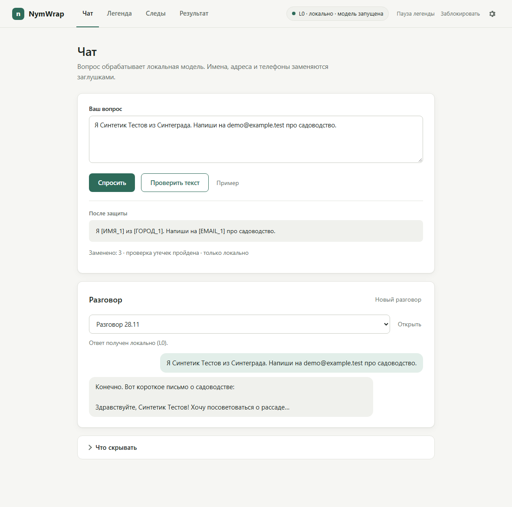
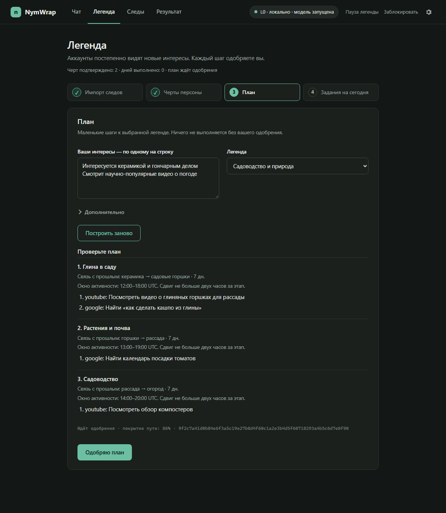
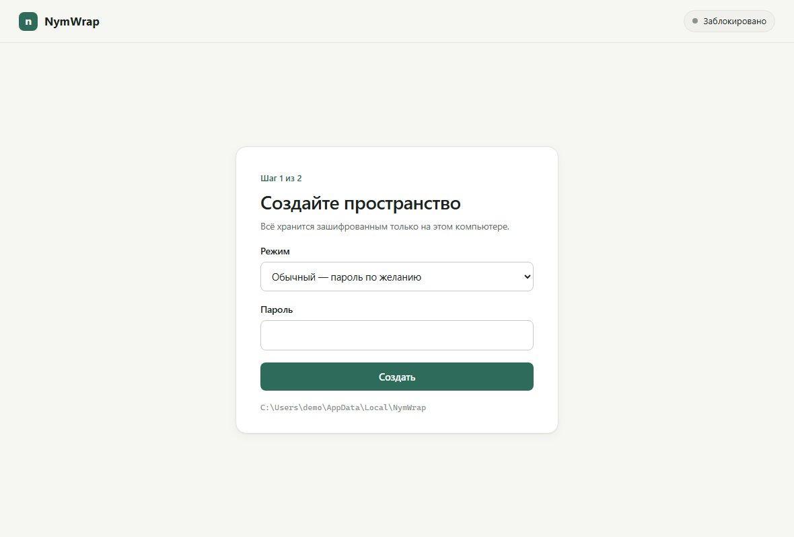
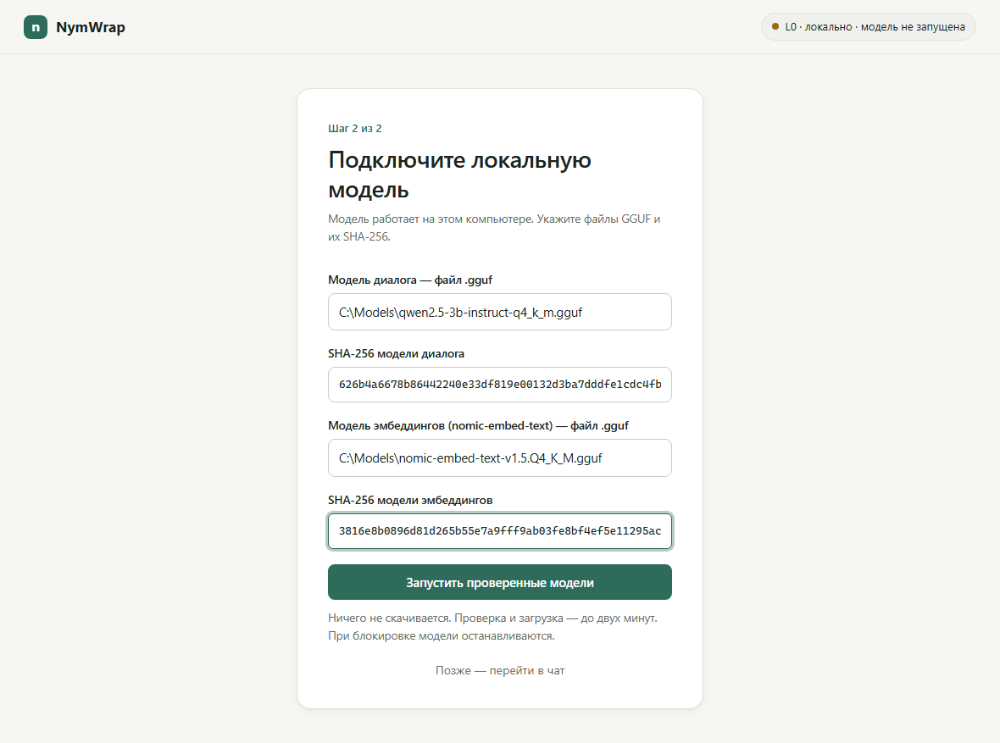
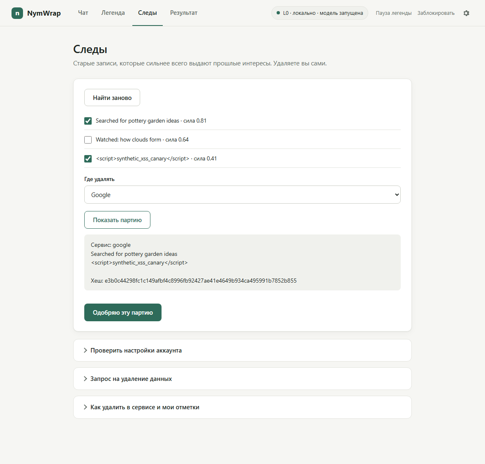
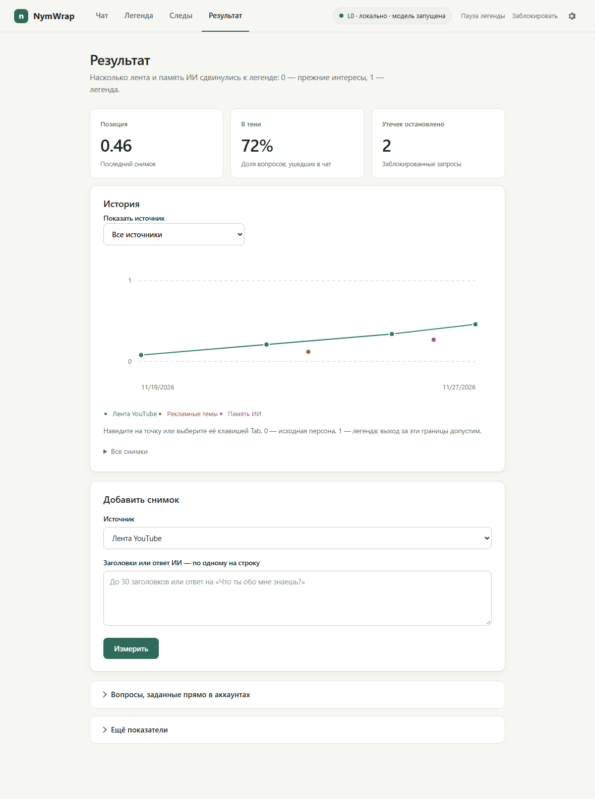

<div align="center">

# NymWrap

**Пусть сервисы и ИИ видят не вас, а выбранную вами легенду.**

Локальная программа для Windows. Личные вопросы она обрабатывает на вашем компьютере,
а аккаунтам постепенно и под вашим контролем показывает другую картину интересов.

[Быстрый старт](#-быстрый-старт-windows) ·
[Как пользоваться](#-как-пользоваться) ·
[Руководство](docs/USER_GUIDE.md) ·
[Модель угроз](docs/THREAT_MODEL.md) ·
[Статус](docs/IMPLEMENTATION.md)

</div>

<table>
  <tr>
    <td width="50%"></td>
    <td width="50%"></td>
  </tr>
  <tr>
    <td align="center"><sub>Чат: личное заменяется заглушками до модели</sub></td>
    <td align="center"><sub>Легенда: план, который вы одобряете сами</sub></td>
  </tr>
</table>

<sub>На скриншотах только синтетические данные.</sub>

## ✨ Что делает

Программа держит две раздельные полосы. **Теневая** — ваши настоящие вопросы, они
не уходят в аккаунты. **Легенда** — то, что постепенно увидят ваши аккаунты.

| Экран | Модуль | Что происходит |
|---|---|---|
| 💬 **Чат** | Shield | Вы задаёте вопрос. Имена, адреса, телефоны и ваши «личные слова» заменяются заглушками, ответ даёт локальная модель (L0). |
| 🎭 **Легенда** | Drift | Импорт вашей истории → черты персоны → план из 10 этапов от ваших интересов к легенде → задания на день. |
| 🧹 **Следы** | Purge | Находит записи, которые сильнее всего выдают прошлый профиль, и собирает партию на удаление. |
| 📈 **Результат** | Mirror | Снимки ленты, рекламных интересов и памяти ИИ: насколько профиль сдвинулся к легенде. |

Всё хранится зашифрованным на вашем компьютере. Без вашего одобрения не выполняется
ни план, ни удаление. Телеметрии нет.

## 🚀 Быстрый старт (Windows)

### 1. Установите

| Что | Где взять | Заметка |
|---|---|---|
| Git | [git-scm.com](https://git-scm.com/download/win) | |
| Rust | [rustup.rs](https://rustup.rs) | нужную версию (1.100.0) rustup поставит сам из `rust-toolchain.toml` |
| Node.js 24+ | [nodejs.org](https://nodejs.org) | |
| Visual Studio 2022 Build Tools | [visualstudio.microsoft.com](https://visualstudio.microsoft.com/visual-cpp-build-tools/) | компонент «Разработка классических приложений на C++» с Windows SDK |
| WebView2 | обычно уже есть в Windows 10/11 | |

Нужно около 20 ГБ свободного места: сборка, инструменты и модели.

### 2. Скачайте проект

```powershell
git clone https://github.com/dsahakyan15/NymWrap.git
cd NymWrap
```

### 3. Подготовьте инструменты сборки

```powershell
Set-ExecutionPolicy -Scope Process Bypass   # разрешить скрипты только в этом окне
./scripts/bootstrap-perl.ps1
./scripts/bootstrap-libclang.ps1
```

Скрипты скачивают Perl и libclang закреплённых версий, проверяют SHA-256 и кладут их
в `target/tools`. Систему они не меняют.

### 4. Скачайте модели

```powershell
./scripts/fetch-test-models.ps1 -IncludeMidSizeChat
Get-ChildItem target\test-models\*.gguf | Get-FileHash   # полные пути и SHA-256
```

| Роль | Файл | Размер | SHA-256 |
|---|---|---|---|
| **Модель диалога** (рекомендуется) | `qwen2.5-3b-instruct-q4_k_m.gguf` | ≈ 2 ГБ | `626b4a6678b86442240e33df819e00132d3ba7dddfe1cdc4fbb18e0a9615c62d` |
| **Модель эмбеддингов** | `nomic-embed-text-v1.5.Q4_K_M.gguf` | ≈ 80 МБ | `d4e388894e09cf3816e8b0896d81d265b55e7a9fff9ab03fe8bf4ef5e11295ac` |
| лёгкая проверка | `qwen2.5-0.5b-instruct-q4_k_m.gguf` | ≈ 470 МБ | `74a4da8c9fdbcd15bd1f6d01d621410d31c6fc00986f5eb687824e7b93d7a9db` |

Модели скачиваются из официальных репозиториев Qwen и nomic на Hugging Face по
закреплённым ревизиям. Если хеш не совпал, скрипт останавливается и файл не принимает. Сама программа модели
никогда не скачивает.

> [!NOTE]
> С 0.5B работают чат, импорт и черты персоны, но план легенды она не строит.
> Для полного сценария нужна 3B.

### 5. Запустите

```powershell
cd app
npm ci
npm run desktop
```

Первая сборка идёт долго, обычно десятки минут: компилируются демоны, llama.cpp,
SQLCipher и Tor. Следующие запуски — за секунды.

<details>
<summary>Собрать отдельную release-версию</summary>

```powershell
cd app
npm run desktop:build
.\src-tauri\target\release\nymwrap-app.exe
```

Все нужные демоны лежат рядом с `nymwrap-app.exe` в `app\src-tauri\target\release`.
Этот комплект не подписан. Как проверить подписанный выпуск — в
[руководстве](docs/USER_GUIDE.md#проверка-скачанного-выпуска).

</details>

## 🧭 Как пользоваться

### Первый запуск

<table>
  <tr>
    <td width="50%"></td>
    <td width="50%"></td>
  </tr>
</table>

1. **Создайте пространство.** Режим «Обычный» допускает пустой пароль, «Строгий»
   требует пароль от 12 знаков. Ключ шифрования хранится в Windows Credential Manager.
2. **Подключите модели.** Вставьте полные пути к двум `.gguf` и их SHA-256 из шага 4
   и нажмите **«Запустить проверенные модели»**. Загрузка занимает до двух минут.
   Статус вверху сменится на «L0 · локально · модель запущена».

### 💬 Чат

1. Напишите вопрос и нажмите **«Проверить текст»**. Вы увидите, что останется после
   защиты, например `Я [ИМЯ_1] из [ГОРОД_1]`.
2. Нажмите **«Спросить»**. Ответ даёт локальная модель, в нём возвращаются ваши
   настоящие значения.
3. В блоке **«Что скрывать»** добавьте свои личные слова, по одному на строку:
   имя ребёнка, название фирмы, ник.

### 🎭 Легенда

Четыре шага. Готовый шаг отмечается ✓.

1. **Импорт следов.** Выберите экспорт (Google Takeout, ChatGPT, Claude, Gemini или
   история браузера) и укажите файл. Для пробы есть **«Синтетический пример»**.
2. **Черты персоны.** Нажмите **«Найти черты»**. Модель предложит черты, каждая
   с доказательством. Отметьте те, что правда про вас, и нажмите **«Подтвердить выбранные»**.
3. **План.** Проверьте свои интересы, выберите легенду (например, «Садоводство и
   природа») и нажмите **«Построить план»**. На обычном процессоре это занимает около
   минуты. Прочитайте все 10 этапов и нажмите **«Одобряю план»**.
4. **Задания на сегодня.** Короткий список поисков и видео на сегодня. Выполните
   их сами или через расширение браузера. Следующий день откроется не раньше чем
   через 12 часов.

> [!TIP]
> Пауза легенды — кнопка в шапке. Она останавливает задания, но ничего не удаляет.

### 🧹 Следы



1. Нажмите **«Найти записи»**. Появятся записи, которые сильнее всего выдают
   прошлый профиль.
2. Отметьте нужные, нажмите **«Показать партию»**, проверьте её и нажмите
   **«Одобряю эту партию»**.
3. Удаляете вы сами в аккаунте: программа подскажет, где это сделать.
   **«Подготовить шаблон»** даёт текст официального запроса на удаление данных.

### 📈 Результат



Нажмите **«Добавить снимок»**, выберите источник (лента YouTube, рекламные интересы,
подсказки поиска, память ИИ, Takeout), вставьте заголовки по одному на строку и нажмите
**«Измерить»**. График покажет, сдвигается ли профиль от прошлого к легенде.

### 🔒 Блокировка и удаление

- **«Заблокировать»** в шапке закрывает пространство и останавливает модели.
- ⚙️ **Настройки → Удалить данные** уничтожает выбранные данные: импорт, историю чата,
  персону, снимки или всё сразу. Для подтверждения введите «СТЕРЕТЬ», а для всех данных — «СТЕРЕТЬ ВСЁ».

## 🛡️ Как устроена защита

- **Полосы не смешиваются.** Процессы легенды получают только текст легенды;
  настоящая история и чат им недоступны.
- **В сеть выходит один процесс** — `nw-netd`. Каждый запрос перед выходом проходит
  проверку утечек. Если транспорт не работает, отправка запрещается.
- **Последнее слово за кодом.** Всё, что пишет модель, проверяется кодом: план,
  черты, переписанный текст.
- **На диске только шифротекст.** SQLCipher и отдельный ключ на каждый домен данных.
- **Человек одобряет.** План, партии удаления и в строгих режимах каждый исходящий
  запрос.
- **Честная автоматизация.** Человеческий темп, остановка на CAPTCHA и входе, без
  подделки отпечатка браузера.

Подробно: [THREAT_MODEL](docs/THREAT_MODEL.md) и [SPEC](docs/SPEC.md).

## ⚠️ Ограничения

- Живые аккаунты Google, YouTube и ИИ-сервисов не проверялись, только синтетические
  страницы. Гарантии, что сервис действительно изменит профиль или удалит данные, нет.
- План легенды надёжно строит модель от 3B. 0.5B для этого не годится, 7B на CPU не
  укладывается в лимит времени.
- Режим `paranoid` работает только локально (L0). Nym и zkAPI экспериментальные
  и выключены.
- Независимая проверка несвязываемости Shield дала отрицательный результат:
  5 из 39 разговоров против случайных 1 из 64.
- Часть native-зависимостей (OpenSSL, SQLCipher, llama.cpp) принята как
  риск без аудита ([ADR 0111](docs/adr/0111-scoped-cargo-vet-exemptions.md)).
  Первый выпуск не подписан.

Полная сверка с критериями: [IMPLEMENTATION](docs/IMPLEMENTATION.md).

## 📚 Документы

| Документ | Для кого |
|---|---|
| [USER_GUIDE](docs/USER_GUIDE.md) | подробное руководство: импорт, расширение, Tor, хранение |
| [SPEC](docs/SPEC.md) | архитектура, модули, этапы M0–M7 |
| [THREAT_MODEL](docs/THREAT_MODEL.md) | противники, защиты, чек-лист |
| [IMPLEMENTATION](docs/IMPLEMENTATION.md) | что сделано и чем подтверждено |
| [docs/adr](docs/adr) | принятые решения |

## 🛠️ Для разработчиков

Проверки: `scripts/check.ps1` или `scripts/check.sh`. Сквозной тест того же пути, что
использует приложение, с моделью 3B: `node tests/e2e/local.mjs --with-os-keystore --model-3b`.

<details>
<summary>Что реализовано</summary>


- SQLCipher по отдельным доменам, XChaCha20-Poly1305, OS key store + Argon2id,
  защищённые ключи в памяти, retention и crypto-shredding.
- nymwrapd владеет пространством. UI и OpenAI API используют общую историю;
  разговоры продолжаются после повторного открытия с прежними плейсхолдерами.
- Собственный CPU worker llama.cpp, проверка GGUF по SHA-256, приватные Unix
  sockets / Windows named pipes, без TCP-коннектора модели; native GGUF/inference
  на Windows в одноразовом LPAC с дескрипторами моделей только на чтение.
- Импорт JSON/HTML/ZIP, SQLite backup Chrome/Firefox/Safari в памяти, отдельный
  ограниченный worker. Локальная персона с подтверждением каждого утверждения.
- Проверка плана эмбеддингами, одобрения по хешу, отдельные формулировки дня,
  сохранение прогресса, пауза и минимум 12 часов между днями.
- Purge: ранжирование и одобрение партии удаления; Mirror: снимки и измерения.
  Расширение получает только одобренные задания легенды через native messaging.
- Tor с отдельной изоляцией разговоров, HTTPS, EFS/fscrypt для состояния,
  аутентифицированный IPC, полный Shield/NER/Route, резерв бюджета до send,
  отсутствие retry/fallback и завершение дочернего процесса с ядром.
- Одноразовый просмотр без повторного вызова модели, TTL, привязка к провайдеру;
  фоновые синтетические приманки с зашифрованными слотами и uncertain без replay.

Локальные проверки включают настоящий CPU inference, Credential Manager,
сквозной HTTP API через named pipe, перезапуск core, отсутствие синтетического
открытого текста в store и разные идентификаторы настоящих Tor-цепочек.
Они не заменяют CI, захват всего трафика, 24-часовой fuzz, подписи и аудит M6.


</details>

<details>
<summary>CLI, HTTP API и сквозной тест</summary>


После `. ./scripts/build-env.ps1`:

```powershell
cargo run -p nw-core --bin nymwrap -- demo
cargo run -p nw-core --bin nymwrap -- paths
Get-Content -Raw export.json | cargo run -p nw-core --bin nymwrap -- audit takeout
cargo run -p nw-api -- --help
```

`nymwrap rpc` отключён (ADR 0076): открытым пространством управляет только
приложение через авторизованную сессию nymwrapd. API требует открытого
пространства и работающей локальной модели. После Lock/DestroyData runtime-сессия
core завершается; UI запускает её снова.

Сквозная проверка того же пути, что использует UI (пространство Standard,
импорт синтетического Takeout, проверенные модели, L0 через named pipe, Drift,
Purge, Mirror), — `node tests/e2e/local.mjs --with-os-keystore`. Обёртка собирает
демоны и запускает `crates/nw-core/tests/desktop_flow.rs` во временном каталоге;
пространство и запись в хранилище ключей ОС удаляются в конце. Перед запуском
закройте приложение и выполните scripts/fetch-test-models.ps1. С 0.5B план Drift
обычно не проходит проверки кода (`plan_checks_failed`, тест пишет NOT VERIFIED);
`--model-1.5b`, `--model-3b` (`fetch-test-models.ps1 -IncludeMidSizeChat`) и
`--model-7b` выбирают более крупные модели. С `--model-3b` весь сценарий проходит
без NOT VERIFIED (на CPU около 19 минут). 1.5B проходит Drift, Purge и Mirror, но её
исследование персоны отклоняется кодом. 7B не укладывается в лимит одного вызова.

Полная инструкция, импорт SQLite WAL, подключение расширения и ограничения:
[USER_GUIDE](docs/USER_GUIDE.md). Требования безопасности:
[THREAT_MODEL](docs/THREAT_MODEL.md).


</details>

<details>
<summary>Проверки, сборка, браузерные и модельные тесты</summary>


Проверки: `scripts/check.ps1` или `scripts/check.sh`. Source SBOM строится
`node scripts/sbom.mjs --target x86_64-pc-windows-msvc --out target/nymwrap.cdx.json`
после получения зависимостей всех трёх Cargo-workspace; официальная схема
проверяется `./scripts/validate-sbom.ps1 -Path target/nymwrap.cdx.json`.
Это ведомость исходных компонентов, не подпись готовой программы.


Для `check.ps1` нужен PowerShell 7 (`pwsh`), включая проверку SBOM по JSON Schema.
Windows PowerShell 5.1 подходит для базовой сборки, но не полного check.ps1.

```powershell
./scripts/check.ps1
node tests/e2e/local.mjs --with-os-keystore
cd app
npm run desktop:build
```

Сквозной тест использует синтетические данные, локальные модели в target/test-models
и настоящий OS key store; рабочее приложение перед ним нужно закрыть. Он удаляет
только собственное тестовое пространство. Linux/macOS: scripts/check.sh.

После desktop:build добавьте `--release` к команде сквозного теста для проверки
соседних бинарников из app/src-tauri/target/release; `--with-tor` включает
ограниченный тест публичной Tor-сети с синтетическими ключами. Coverage/ASan
и отдельная 24-часовая кампания описаны в [fuzz/README.md](fuzz/README.md).

Изолированные проверки расширения в настоящих Chromium и Firefox запускаются отдельно:
из `extension` выполните `npm ci`, `npm run browser:install`, на Windows также
`npm run firefox:install`, затем `npm run test:browser`.
Нужен PowerShell 7 для временного TLS-сертификата. Тесты используют синтетические
HTTPS-страницы на loopback, собственный профиль и тестовый native host; реальные
сервисы и профиль браузера не затрагиваются. В CI выделена отдельная Linux/Windows
задача; штатный Firefox пока проверяется на Windows. Отдельная явная команда
`npm run probe:public:firefox` читает живые публичные Google/YouTube/MyAdCenter и
страницы трёх ИИ-сервисов в новом профиле без входа, запросов или сообщений.
Она сохраняет только состояния/количества в target/browser-tests/reports.
Это не проверка аккаунтных интерфейсов и не обход CAPTCHA.

Настоящий Firefox Native Messaging → release nw-drift-host → core проверяется
отдельно: после desktop:build и firefox:install выполните из extension
npm run test:native:firefox. Нужны Rust и PowerShell 7; модели не запускаются.
Тест создаёт пустое синтетическое пространство и уникальную временную запись
HKCU для native host, проверяет паузу/возобновление и удаляет регистрацию,
пространство и профиль. Основная регистрация NymWrap не меняется. Рабочий desktop
перед этим тестом должен быть закрыт. JavaScript продукта и CSP сохраняются;
в тестовой копии меняется только имя host и запуск popup.

Качество NER измеряется отдельно от корректности JSON. После получения тестовых
моделей и сборки worker выполните `cargo build -p nw-llm --example privacy_eval --locked`,
затем `node scripts/privacy-eval.mjs --release --report-only`. Флаг `--release`
выбирает worker из desktop-комплекта; без него нужен target/debug/nw-llmd.
Синтетический отчёт и SHA-256 инструментов появятся в target/privacy-eval/latest.json.
Без `--report-only` пропуск, отвергнутый ответ или ошибка дают ненулевой exit code.
Маленькая тестовая Qwen 0.5B не проходит этот критерий качества; она подходит для
проверки движка и безопасных отказов. Корпус не доказывает отсутствие утечек на
произвольных данных и не заменяет список секретов или просмотр перед отправкой.

Расширенная проверка выполняет настоящий Engine на 62 синтетических кейсах,
включая EN/RU/HY, кодировки, инъекции и связывание косвенных признаков между
двумя ходами. Дополнительная Qwen2.5-7B Q4_K_M закреплена в scripts/privacy-models.json:

```powershell
node scripts/fetch-privacy-model.mjs qwen2.5-7b-q4_k_m
node scripts/merge-privacy-model.mjs qwen2.5-7b-q4_k_m
cargo build -p nw-llmd --release --locked
cargo build -p nw-core --example privacy_pipeline --locked
node scripts/privacy-benchmark.mjs --model smoke
node scripts/privacy-benchmark.mjs --model qwen2.5-7b-q4_k_m
node scripts/privacy-report.mjs
```

Сначала нужны небольшая контрольная модель и nomic из fetch-test-models.ps1.
Скачивается около 4,7 GB; сохраняются части и объединённый GGUF. Ограниченный
Node-парсер меняет только метаданные и смещения, проверяя байты тензоров;
нативная загрузка остаётся внутри LPAC. Повторно объединять уже готовый файл
команда не будет. Производный SHA-256 — в target/test-models/*.merged.json.
Проверка копирует бинарники под их хешами, пишет checkpoint после каждого кейса;
`--limit N` ограничивает запуск, `--resume` продолжает при том же происхождении.
При смене Cargo features перед resume повторите точную команду сборки примера.
Модельные прогоны выполняйте последовательно, после завершения ресурсоёмких
сборок: CPU-нагрузка может превратить долгую генерацию в безопасный таймаут.
Время в отчёте не является сравнительным тестом производительности.

Отчёт target/privacy-eval/report.html разделяет утечки, L0, отказы, сохранение
публичной задачи и попытки связывания с восемью вымышленными профилями.
Исходящего сетевого запроса нет: штатное формирование перехватывается в памяти.
Сырые тексты и вывод модели в отчёт не попадают. Это не процент анонимности
реального человека; вход в аккаунт или оплаченный API-ключ остаются привязками.
Отдельную исходную NER-проверку из 16 кейсов можно повторить на 7B:
`node scripts/privacy-eval.mjs --model qwen2.5-7b-q4_k_m --benchmark-worker --report-only`.
`--benchmark-worker` использует проверенную копию worker из текущего benchmark,
даже если desktop-сборка уже заменила исходный exe; `--root-release` выбирает
текущий target/release без привязки к benchmark.
Флаг `--model-7b` у tests/e2e/local.mjs выбирает подготовленный 7B GGUF для
проверки настоящего core/HTTP, финальных ответов L0 и сохранённого разговора.
В этом тесте создаётся только синтетическое пространство; рабочий desktop
перед ним должен быть закрыт, как и для обычного E2E.

Linux-изоляцию можно проверить из Windows без WSL и администратора:
`node scripts/linux-isolation-probe.mjs --prepare`. Явная команда получает
закреплённые QEMU/Alpine/7-Zip в target/tools и musl target Rust. Установщики
не запускаются, Windows не перенастраивается. Linux работает в RAM; в гостя
передаются только синтетические test executables. Под UID 1000 проверяются
seccomp для старых/новых потоков и bwrap с единственным API socket, без TCP/UDP
или приватного файла вне рабочего каталога в Linux-госте. Отчёт и serial.log — в target/linux-isolation.
Это проверка конкретных границ, а не замена проверки всех демонов или MicroVM
для пользовательских агентов. Последующие запуски допускают отсутствие --prepare.

Release-бинарники и необходимые соседние демоны появляются в
app/src-tauri/target/release. Статический app/dist/index.html показывает интерфейс;
для действий нужен Tauri. Модели, регистрация native host и установка расширения
выполняются отдельно пользователем.

</details>
