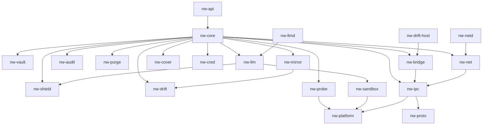

# Архитектура NymWrap: путеводитель по коду

Это техническое руководство для чтения исходников школьного проекта. Оно описывает ревизию `04b051e` от 2026-11-28: устройство программы,
потоки данных и места, где код принимает решения безопасности. Наличие интерфейса, тестовой реализации или ADR не означает готовность
функции. Текущий статус приёмки и исторические доказательства собраны в [IMPLEMENTATION.md](IMPLEMENTATION.md), требования — в
[SPEC.md](SPEC.md), границы защиты — в [THREAT_MODEL.md](THREAT_MODEL.md).

## Содержание

1. [Две полосы и восемь инвариантов](#1-две-полосы-и-восемь-инвариантов)
2. [Процессы, запуск и песочницы](#2-процессы-запуск-и-песочницы)
3. [Карта crates и зависимостей](#3-карта-crates-и-зависимостей)
4. [IPC и авторизация](#4-ipc-и-авторизация)
5. [Конвейеры запросов](#5-конвейеры-запросов)
6. [Drift: от импорта до выполнения](#6-drift-от-импорта-до-выполнения)
7. [Purge и Mirror](#7-purge-и-mirror)
8. [Хранение и криптография](#8-хранение-и-криптография)
9. [Локальные модели](#9-локальные-модели)
10. [Сеть и жёсткие данные устройства](#10-сеть-и-жёсткие-данные-устройства)
11. [UI и расширение](#11-ui-и-расширение)
12. [Тестирование, CI и локальные команды](#12-тестирование-ci-и-локальные-команды)
13. [Как читать код](#13-как-читать-код)
14. [Известные ограничения](#14-известные-ограничения)

## 1. Две полосы и восемь инвариантов

**Shadow** обрабатывает настоящие вопросы, историю, секреты и исходные данные. **Cover** получает одобренные действия легенды для аккаунтов
пользователя. Это разные назначения данных, а не два варианта одного сетевого прокси. Тип `Lane` определён в
[nw-proto](../crates/nw-proto/src/lib.rs).

```text
Настоящие вопросы ── Shield ── L0: локальная модель
                         └── L3: проверенный текст → nw-netd → Tor → провайдер

Импорт → персона → выбранная легенда → проверенный план → одобрение
                                                       │
                                             cover-only DriftTask
                                                       ↓
                                        расширение → настоящий браузер
```

Слово «cover» употребляется ещё в одном смысле: `nw-cover` создаёт **теневые сетевые приманки**. Они принадлежат shadow, не являются
действиями легенды и не берутся из персоны. Источники: [nw-cover](../crates/nw-cover/src/lib.rs),
[decoys.rs](../crates/nw-core/src/service/backend/remote/decoys.rs).

| № | Инвариант | Где код его поддерживает | Практическая граница |
|---|---|---|---|
| 1 | Полосы раздельны | `Envelope::validate`, `Endpoint`, `Packet`; закрытый enum команд [nw-bridge](../crates/nw-bridge/src/lib.rs); `Domain::lane` в [nw-vault](../crates/nw-vault/src/lib.rs) | Core обслуживает два разных listener; UI показывает обе категории. Это ещё не физически отдельный core/UI на каждую полосу. |
| 2 | Удалённый выход через `nw-netd`, fail-closed | `Route::send_now` в [remote.rs](../crates/nw-core/src/service/backend/remote.rs), [Tor::exchange](../daemons/nw-netd/src/lib.rs), [Linux launcher](../crates/nw-net/src/launcher.rs) | Это путь удалённых запросов Shield. Cover-браузер использует собственную сеть; полный запрет сокетов всех desktop-процессов пока не реализован. |
| 3 | Последнее слово за кодом | `Shield::checked_output` в [nw-shield](../crates/nw-shield/src/lib.rs), `Plan::evaluate` в [nw-drift](../crates/nw-drift/src/lib.rs), [planning.rs](../crates/nw-core/src/planning.rs), `validate` в [netd](../daemons/nw-netd/src/lib.rs) | Модель не выдаёт сетевое разрешение и не исполняет команды. Проверка формата не доказывает смысловую анонимность. |
| 4 | Содержимое на диске зашифровано | `Store`, SQLCipher и шифрование записей в [store.rs](../crates/nw-vault/src/store.rs); `LockedKey` в [nw-platform](../crates/nw-platform/src/lib.rs) | Правило относится к чувствительным данным приложения. GGUF, бинарники, статические ресурсы, salt и технические заголовки не являются секретными зашифрованными записями. |
| 5 | Недоверенный текст — данные | `quoted_data` в [nw-shield](../crates/nw-shield/src/lib.rs), фиксированные инструкции [nw-llm](../crates/nw-llm/src/lib.rs), `textContent` в [UI](../app/src/main.ts) | Импорт, ответ модели и страница не становятся скриптом, shell-командой или произвольным URL. |
| 6 | Человек одобряет | `CheckedPlan::approve`, `CheckedDay::approve`; [remote_review.rs](../crates/nw-core/src/remote_review.rs); `Batch::approve` в [nw-purge](../crates/nw-purge/src/lib.rs) | План, день и партия связаны с хешем. Для remote действуют профиль и настройка просмотра; API не имеет права одобрять. |
| 7 | Честная автоматизация | [execution.ts](../extension/src/execution.ts), [safety.ts](../extension/src/safety.ts), одноразовые разрешения в [execution.rs](../crates/nw-core/src/workspace/execution.rs) | Есть темп печати и чтения, остановки CAPTCHA/login. Живые видео и ИИ-чаты не автоматизированы этими адаптерами. |
| 8 | Журналы без содержания, без телеметрии | Фиксированные ошибки в [daemon.rs](../crates/nw-core/src/daemon.rs), [nw-llmd](../crates/nw-llmd/src/lib.rs), метаданные заданий в [traffic.rs](../crates/nw-core/src/workspace/traffic.rs) | Зашифрованная история чата — пользовательские данные, а не диагностический журнал. Тестовые/evaluation-инструменты имеют отдельную область. |

Инварианты — требования проекта из [AGENTS.md](../AGENTS.md). Незакрытые границы процессов и ОС подробно объясняют [ADR
0093](adr/0093-core-key-and-launch-broker.md) и [ADR 0094](adr/0094-macos-seatbelt-process-profiles.md).

## 2. Процессы, запуск и песочницы

### 2.1. Какие бинарники существуют

Библиотека crate и процесс — разные вещи: `nw-core` содержит библиотеку, CLI `nymwrap` и демон `nymwrapd`; `nw-audit` содержит библиотеку и
worker. Имена заданы в [Cargo.toml ядра](../crates/nw-core/Cargo.toml), [Cargo.toml импорта](../crates/nw-audit/Cargo.toml) и [Cargo.toml
desktop](../app/src-tauri/Cargo.toml).

| Бинарник | Чем владеет и что выполняет | Полоса/граница данных | Сеть в текущей реализации |
|---|---|---|---|
| `nymwrap-app` | Окно Tauri, `Proxy`, отображение, вызовы типизированного core RPC; [main.rs](../app/src-tauri/src/main.rs) | Доверенный UI показывает shadow и результаты cover | У frontend нет произвольного HTTP по CSP; полная OS-песочница GUI не подключена. |
| `nymwrapd` | Единственный разблокированный `Workspace`, `Store`, `Engine`, модельные children, jobs и планировщик; [daemon.rs](../crates/nw-core/src/daemon.rs) | Shadow-координатор с узким cover endpoint | Linux запрещает IP-сокеты; remote требует заранее подготовленный transport netns. Windows/macOS core ещё не имеет полной OS-изоляции. |
| `nw-api` | Приватный HTTP listener и перевод запросов OpenAI в core RPC; [main.rs](../crates/nw-api/src/main.rs) | Shadow, ограниченная роль `Api` | Unix socket/named pipe, без TCP listener; Windows/Linux leaf sandbox. |
| `nw-netd` | Arti, HTTPS к одному настроенному provider, состояние Tor и дочерний PT; [main.rs](../daemons/nw-netd/src/main.rs) | Shadow, получает подготовленный текст и credential | Единственный прикладной transport Shield с внешними сокетами; обычный send только через Arti. |
| `nw-llmd` | Загрузка GGUF, native llama.cpp, completion и embeddings; [main.rs](../crates/nw-llmd/src/main.rs) | Shadow, текст текущего модельного вызова | Локальные IPC/stdio; workers без внешней сети. На Windows — свежий LPAC на вызов. |
| `nw-audit-worker` | Разбор переданных байтов экспорта, возврат ограниченной сводки; [worker](../crates/nw-audit/src/bin/nw-audit-worker.rs) | Shadow, исходные данные импорта | Без сети; production import supervisor реализован для Windows/Linux. |
| `nw-drift-host` | Native Messaging браузера и relay к cover listener; [main.rs](../crates/nw-drift-host/src/main.rs) | Cover, команды легенды и снимки Mirror | Сеть выполняет браузер. Windows/Linux изолируют разбор в дочернем relay. |
| `nw-probe` | Одноразовый сбор идентификаторов и наблюдений гигиены; [main.rs](../crates/nw-probe/src/main.rs) | Shadow, привилегированный по назначению read-only inventory | Без сети; разрешены нужные локальные источники устройства, недоступные обычной модели. |
| `nymwrap` | `status`, `paths`, `demo`, `shield`, `audit`, `purge-template`, `run`; [main.rs](../crates/nw-core/src/main.rs) | Shadow/offline; не получает control-ключ открытого desktop | Linux запрещает IP-сокеты. Команда `rpc` отклоняется; `run` запускает изолированного агента. |
| `nw-sandbox` | Явный launcher ролей macOS; [main.rs](../crates/nw-sandbox/src/main.rs) | Полоса и роль задаются доверенным coordinator | Seatbelt-профиль; на других ОС этот CLI возвращает unsupported. |

### 2.2. Дерево запуска

```text
nymwrap-app / Proxy
  │ свежий control-ключ через inherited stdin, удерживаемый child
  └─ nymwrapd
       ├─ nw-api             API-ключ другой, роль Api
       ├─ nw-netd            отдельный egress-ключ и lifetime pipe
       │    └─ Lyrebird      только если настроен разрешённый PT
       ├─ nw-llmd            запуск по StartModel; схема зависит от ОС
       ├─ nw-audit-worker    одна операция импорта
       └─ nw-probe           одна инвентаризация

браузер пользователя
  └─ nw-drift-host           запуск по регистрации Native Messaging
       └─ sandbox relay     Windows/Linux, только cover IPC
                │
                └────────→ cover listener того же nymwrapd

nymwrap run
  └─ агент в bwrap либо opt-in Firecracker → только приватный nw-api
```

`Proxy::ready` ищет установленный соседний `nymwrapd`, а в debug также путь сборки; `Client::spawn_daemon` создаёт новый экземпляр с новым
ключом. Чужой уже работающий core не становится доверенным из-за имени файла. Детали: [Tauri Proxy](../app/src-tauri/src/main.rs),
[service/process.rs](../crates/nw-core/src/service/process.rs).

Core запускает API и обслуживает shadow RPC, cover RPC и traffic loop. `nw-netd` удерживается через `Client`; при EOF родительского pipe его
работа прекращается. Таймаут, Drop и сохранённые объекты children ограничивают lifetime; при неизвестном результате запрос автоматически не
воспроизводится. См. [daemon.rs](../crates/nw-core/src/daemon.rs), [net/client.rs](../crates/nw-net/src/client.rs),
[netd/main.rs](../daemons/nw-netd/src/main.rs).

Закрытие окна посылает `CloseSession`: либо обычная блокировка, либо ранее разрешённый фоновый хвост standard. У хвоста нет новых
пользовательских задач; модель/транспорт и ключи освобождаются при завершении сессии. Это реализуют [Tauri close
handler](../app/src-tauri/src/main.rs) и [timing.rs](../crates/nw-core/src/service/backend/timing.rs).

### 2.3. Что действительно изолировано на разных ОС

| Граница | Windows | Linux | macOS |
|---|---|---|---|
| API, модель, cover relay | LPAC; Job Object запрещает children, уничтожает процесс при закрытии job; точечные pipe capabilities | `bwrap`, отдельные mount/user/net/IPC/UTS/cgroup namespaces, seccomp до exec и TSYNC после старта | Есть явные Seatbelt-роли, desktop пока не запускает их автоматически. |
| Parser импорта | Отдельный AppContainer worker с bounded stdio | Изолированный worker и seccomp, без исходных пользовательских каталогов | `nw-core::audit_offline` возвращает `import_sandbox_unavailable`. |
| Device probe | Специальный AppContainer без сетевых/location/Wi-Fi capabilities; часть источников остаётся unknown | Специальный read-only worker; разрешён нужный inventory, не домашний каталог целиком | Собственный deny-default Seatbelt-профиль применяется до чтения входа. |
| Core/netd | Полная AppContainer-изоляция этих двух процессов не реализована | Административная подготовка: пустой netns core, отдельный заранее подготовленный netns netd, сброс UID/GID/groups; core seccomp | Явный `nw-sandbox` launcher существует; полная интеграция desktop отсутствует. |
| Агент `nymwrap run` | Автоматического переноса в WSL2 нет; неподдерживаемый запуск отклоняется | По умолчанию bwrap; MicroVM включается отдельным флагом | Текущий `run_agent` не предоставляет готовый backend macOS. |

Реализация: [sandbox/daemon.rs](../crates/nw-sandbox/src/daemon.rs), [profiles/daemons.json](../crates/nw-sandbox/profiles/daemons.json),
[windows_sandbox.rs](../crates/nw-platform/src/sys/windows_sandbox.rs), [linux_leaf.rs](../crates/nw-platform/src/sys/linux_leaf.rs),
[macos.rs](../crates/nw-sandbox/src/macos.rs), [import_worker.rs](../crates/nw-core/src/import_worker.rs).

У Linux leaf-процессов PID namespace намеренно общий с core: иначе kernel peer PID внешнего родителя не подходит существующей
аутентификации. Вместо обещания полного PID-разделения код запрещает опасные process syscalls и не монтирует `/proc`. Обоснование: [ADR
0092](adr/0092-leaf-daemon-sandbox-profiles.md).

### 2.4. Opt-in Firecracker

`nymwrap run --microvm /absolute/tools -- /guest/program` выбирает [microvm.rs](../crates/nw-sandbox/src/microvm.rs). На Linux x86_64
проверяются KVM и SHA-256 инструментов; ошибки дают отказ, а не запуск команды на хосте. Гость получает 1 vCPU, 256 MiB RAM, initramfs,
проект в RAM и один прикладной канал к `nw-api` через vsock relay. NIC, TAP, дисков, host mounts, MMDS и автоматического writeback нет.

Проект ограничен 64 MiB/4096 записями, symlink/hardlink/special files отвергаются. Окружение нормализуется в
[guest-init.c](../scripts/microvm/guest-init.c). Запуск требует выключенного host swap и допустимой политики core dumps; VMM ещё не обёрнут
в jailer/полную файловую песочницу. Это отдельная граница для статических программ, не завершение M6: [ADR
0105](adr/0105-opt-in-shadow-agent-microvm.md), [ADR 0106](adr/0106-pinned-microvm-tools.md).

## 3. Карта crates и зависимостей

Root [Cargo.toml](../Cargo.toml) объединяет `crates/*` и `tests/leak`. Tauri, netd и fuzz имеют отдельные manifests/lockfiles. В таблице
перечислены все 20 crates из `crates/` и отдельный daemon; зависимости — внутренние runtime-связи, без внешних библиотек и dev-dependencies.

| Crate | Ответственность и главные точки входа | Внутренние зависимости |
|---|---|---|
| `nw-proto` | `Lane`, `Profile`, `TrustLevel`, `DriftTask`, `Envelope`; [lib.rs](../crates/nw-proto/src/lib.rs) | Нет |
| `nw-platform` | Безопасные оболочки OS API, `LockedKey`, `LockedString`, hardening; [lib.rs](../crates/nw-platform/src/lib.rs), [sys.rs](../crates/nw-platform/src/sys.rs) | Нет |
| `nw-ipc` | `Endpoint`, `Listener`, `Packet<T>`, frame read/write, kernel peer identity; [lib.rs](../crates/nw-ipc/src/lib.rs) | proto, platform |
| `nw-shield` | `Shield`, `ConversationVault`, `Prepared`; [lib.rs](../crates/nw-shield/src/lib.rs), [ner.rs](../crates/nw-shield/src/ner.rs), [hard.rs](../crates/nw-shield/src/hard.rs), [encoded.rs](../crates/nw-shield/src/encoded.rs) | proto, platform |
| `nw-vault` | `MasterKey`, `KeyRing`, `Domain`; [lib.rs](../crates/nw-vault/src/lib.rs); SQLCipher `Store` в [store.rs](../crates/nw-vault/src/store.rs) | proto, platform |
| `nw-sandbox` | Launcher worker/agent, `daemon::Launch`, macOS и MicroVM; [lib.rs](../crates/nw-sandbox/src/lib.rs), [daemon.rs](../crates/nw-sandbox/src/daemon.rs) | platform |
| `nw-llm` | Trait `LocalModel`, `UnixModel`, DTO модели, Windows supervisor; [lib.rs](../crates/nw-llm/src/lib.rs), [windows_worker.rs](../crates/nw-llm/src/windows_worker.rs) | proto, shield, ipc, sandbox |
| `nw-llmd` | Отдельный native inference worker, `Inference`, `Cpu`; [lib.rs](../crates/nw-llmd/src/lib.rs), [inference.rs](../crates/nw-llmd/src/inference.rs), [isolation.rs](../crates/nw-llmd/src/isolation.rs) | proto, ipc, platform, sandbox, llm |
| `nw-net` | Безсетевой клиент egress, `ShapedRequest`, route policy, wire AEAD; [lib.rs](../crates/nw-net/src/lib.rs), [client.rs](../crates/nw-net/src/client.rs), [wire.rs](../crates/nw-net/src/wire.rs) | proto, shield, platform, ipc |
| `nw-cred` | `CredentialProvider`, `KeyPool`, интерфейс OS provider secrets; [lib.rs](../crates/nw-cred/src/lib.rs), [os.rs](../crates/nw-cred/src/os.rs) | platform |
| `nw-cover` | `Scheduler`, `DailyBudget`, defer/session timing; [lib.rs](../crates/nw-cover/src/lib.rs), [budget.rs](../crates/nw-cover/src/budget.rs), [session.rs](../crates/nw-cover/src/session.rs) | proto |
| `nw-audit` | `Format`, `Summary`, `import`, JSON/HTML/ZIP/SQLite readers; [lib.rs](../crates/nw-audit/src/lib.rs), [formats.rs](../crates/nw-audit/src/formats.rs) | platform |
| `nw-drift` | `Plan`, checked/approved типы, `Progress`, ось, daily variants; [lib.rs](../crates/nw-drift/src/lib.rs), [math.rs](../crates/nw-drift/src/math.rs) | proto |
| `nw-purge` | `rank`, `Signal`, `Batch`, инструкции и шаблон; [lib.rs](../crates/nw-purge/src/lib.rs), [guides.rs](../crates/nw-purge/src/guides.rs) | proto |
| `nw-mirror` | `Snapshot`, `Counters`, `Metrics`, `should_hold`; [lib.rs](../crates/nw-mirror/src/lib.rs) | drift |
| `nw-probe` | `Source`, `Report`, `Hints`, read-only hygiene; [lib.rs](../crates/nw-probe/src/lib.rs), [hygiene.rs](../crates/nw-probe/src/hygiene.rs) | platform, proto |
| `nw-bridge` | Закрытый cover RPC, `Command`, `Handler`, `ExecutionToken`; [lib.rs](../crates/nw-bridge/src/lib.rs) | proto, ipc, platform |
| `nw-drift-host` | `relay` native framing ↔ cover RPC; [lib.rs](../crates/nw-drift-host/src/lib.rs), [main.rs](../crates/nw-drift-host/src/main.rs) | bridge, platform, sandbox, proto, ipc |
| `nw-core` | `Engine`, `Workspace`, service RPC, `planning::generate`, два бинарника; [lib.rs](../crates/nw-core/src/lib.rs), [workspace.rs](../crates/nw-core/src/workspace.rs), [service/mod.rs](../crates/nw-core/src/service/mod.rs) | proto, shield, vault, llm, drift, audit, purge, sandbox, cred, net, cover, platform, ipc, probe, bridge, mirror |
| `nw-api` | Axum `router`, `Backend`, OpenAI DTO и private bind; [lib.rs](../crates/nw-api/src/lib.rs) | proto, core, llm, shield, ipc, platform, sandbox |
| `daemons/nw-netd` | `Tor`, `Provider`, `validate`, `parse_answer`, authenticated dispatcher; [lib.rs](../daemons/nw-netd/src/lib.rs), [server.rs](../daemons/nw-netd/src/server.rs) | net, ipc, platform, proto |

Сокращённый граф именно **Cargo-зависимостей**, а не сетевых соединений:



Почему netd собирается отдельно: Arti и SQLCipher требуют несовместимых ветвей `rusqlite`/нативного `links=sqlite3`. Разделение сборок
сохраняет SQLCipher основного приложения: [ADR 0008](adr/0008-authenticated-tor-egress.md), [manifest netd](../daemons/nw-netd/Cargo.toml).

## 4. IPC и авторизация

### 4.1. Кадр и ограничения

`nw-ipc` реализует локальный транспорт через `interprocess`, а не TCP. Основной кадр — little-endian длина и ровно столько байтов JSON:

```text
+--------------------+----------------------------------------+
| length: u32 LE     | JSON bytes[length]                     |
+--------------------+----------------------------------------+
                      Packet { version, lane, request_id, body }
```

`read_frame` проверяет длину **до выделения** буфера; нулевая длина запрещена. Обычное чтение ограничено 120 с, запись — 30 с, connect — 5
с. Общий hard cap framing равен 16 MiB; конкретный протокол задаёт меньший предел. Источник всех этих правил:
[nw-ipc/lib.rs](../crates/nw-ipc/src/lib.rs).

| Поверхность | Предел/проверка | Исходник |
|---|---|---|
| Обычный `Packet`, `Envelope`, native messaging | 256 KiB; `SCHEMA_VERSION = 1` | [nw-proto](../crates/nw-proto/src/lib.rs), [nw-ipc](../crates/nw-ipc/src/lib.rs) |
| Суммарный текст chat | 64 KiB, до 63 сообщений, последний role=user | [Engine](../crates/nw-core/src/lib.rs) |
| Shadow control RPC | 16 MiB frame; свой authenticated exchange | [service/mod.rs](../crates/nw-core/src/service/mod.rs) |
| HTTP API body | 256 KiB, затем строгий typed parse | [nw-api](../crates/nw-api/src/lib.rs) |
| Egress | `MAX_WIRE = 512 KiB`; framing отдельно учитывает JSON-раздувание envelope | [wire.rs](../crates/nw-net/src/wire.rs), [server.rs](../daemons/nw-netd/src/server.rs) |
| Probe | 128 KiB, shadow/report schema | [nw-probe](../crates/nw-probe/src/lib.rs) |
| Import | До 8 MiB входа и до 4 MiB worker response | [import_worker.rs](../crates/nw-core/src/import_worker.rs) |

`nw-proto::Envelope` — не единственный DTO приложения. У control RPC свои `Command`/`Reply`, у cover — `nw-bridge`, у egress —
`nw-net::wire`; модель имеет HTTP/stdio DTO. Общими остаются полосы, framing и строгие схемы. См.
[service/mod.rs](../crates/nw-core/src/service/mod.rs), [nw-bridge](../crates/nw-bridge/src/lib.rs),
[nw-llmd](../crates/nw-llmd/src/lib.rs).

### 4.2. От пользователя ОС к конкретному процессу

Первый слой: Unix-каталог 0700, socket 0600, проверка euid peer; Windows — явный owner SID, защищённый DACL, запрет remote network-user,
точечные capabilities для разрешённых sandbox pipes. Windows namespace также зависит от пользователя и data root. Код:
[Endpoint/Listener/authenticate](../crates/nw-ipc/src/lib.rs).

Второй слой shadow RPC нужен потому, что один UID не означает одно полномочие:

1. UI создаёт свежий 256-битный ключ для своего core через inherited pipe.
2. Core создаёт другой ключ для API; bootstrap содержит роль и PID родителя.
3. При соединении проверяются kernel PID, зарегистрированный grant и liveness
   удерживаемого child; имя executable само по себе не заменяет grant.
4. Сервер выдаёт случайный challenge; запрос и ответ защищены
   XChaCha20-Poly1305 с AAD, включающим challenge, роль и направление.
5. Роль `Api` допускает только chat/remote chat/embeddings и submit/load/cancel job.
   Команд vault, настроек, одобрения и удаления у неё нет.

Реализация: [auth.rs](../crates/nw-core/src/service/auth.rs), [process.rs](../crates/nw-core/src/service/process.rs),
[service/mod.rs](../crates/nw-core/src/service/mod.rs). Handshake ограничен 2 с; ключи не сохраняются на диск, в argv или environment.

У egress отдельный session key из stdin. AEAD связывает сообщение с монотонным `sequence` и shadow domain AAD; неверный ключ, порядок или
ciphertext отклоняются. До authentication действует короткий deadline, а не bulk-I/O timeout: [wire.rs](../crates/nw-net/src/wire.rs),
[server.rs](../daemons/nw-netd/src/server.rs).

### 4.3. Почему cover не может попросить vault

Endpoint заранее фиксирует ожидаемый `Lane`. `read_packet` сверяет version/lane; `Envelope::validate` дополнительно проверяет полосу самого
`Msg`. `deny_unknown_fields` запрещает «спрятать» shadow-параметр в лишнем поле. Cover handler разбирает только `nw_bridge::Command`:
операции чтения vault в этом enum вообще нет. См. [nw-proto](../crates/nw-proto/src/lib.rs), [nw-ipc](../crates/nw-ipc/src/lib.rs),
[cover.rs](../crates/nw-core/src/service/cover.rs).

Это не означает AEAD-авторизацию каждого cover-клиента по схеме control RPC: cover использует собственную узкую поверхность и OS-проверки
IPC. Границы проверяют [ipc_identity.rs](../tests/leak/src/ipc_identity.rs) и [тесты nw-bridge](../crates/nw-bridge/src/lib.rs).

## 5. Конвейеры запросов

### 5.1. Shield chat L0

1. UI вызывает Tauri `chat`; API вызывает `Command::Chat` через роль `Api`.
   Оба пути приходят в [service/backend.rs](../crates/nw-core/src/service/backend.rs).
2. Service получает настроенный `Engine`, при необходимости восстанавливает
   сохранённый разговор; [workspace.rs](../crates/nw-core/src/workspace.rs).
3. `Engine::chat_with_limit` проверяет roles, объём, `max_tokens`, число ходов
   и точное совпадение переданной старой истории с сохранённой.
   Новый разговор получает случайный 128-битный ID; [lib.rs](../crates/nw-core/src/lib.rs).
4. Для новых сообщений выполняются `minimize`, локальная canonicalize и leakcheck
   канонической копии. В чистом L0 пути remote NER/linkcheck не вызываются.
5. Окончательная локальная модель получает **исходный проверенный transcript**:
   это позволяет решать задачу с настоящими локальными фактами.
   Переписывающие стадии получают маскированный текст; [Engine](../crates/nw-core/src/lib.rs).
6. `force_local = true`: такой разговор нельзя позже повысить до remote,
   потому что локальный ответ мог повторить приватные факты.
7. `finish` проверяет размер ответа, выполняет `rehydrate`, обновляет историю
   только после успеха; [remote_review.rs](../crates/nw-core/src/remote_review.rs).
8. Service сохраняет snapshot в зашифрованные домены и возвращает фактический
   `trust = L0`; [workspace.rs](../crates/nw-core/src/workspace.rs).

`Flights` отменяет/резервирует работу по conversation ID; медленный remote не должен запрещать независимый локальный ответ. Резервации и
commit после ответа находятся в [flight.rs](../crates/nw-core/src/flight.rs) и [Engine](../crates/nw-core/src/lib.rs).

### 5.2. Удалённый L3: от исходного текста до Tor

```text
исходная история + vault
       ↓ deterministic minimize
маскированный новый текст
       ↓ local NER → проверенные буквальные spans → дополнительная маскировка
       ↓ canonicalize / optional English
       ↓ leakcheck
каноническая история → cumulative linkcheck → generalize новых user messages
       ↓ повторные проверки / L0 при риске
финальный leakcheck → Prepared → preview/hash → одноразовое принятие
       ↓ shape → допуск слота/сеанса → credential lease + durable budget
authenticated egress IPC → nw-netd validate → Arti → TLS → HTTP provider
       ↓ проверка ответа
core rehydrate → зашифрованная история → UI/API
```

| Шаг | Что происходит и почему | Реализация |
|---|---|---|
| 1. Разговор | Проверяются история, лимиты, незавершённый review и concurrent flight. У remote-разговора закреплён routing context. | [Engine::chat_using](../crates/nw-core/src/lib.rs) |
| 2. Minimize | Личные секреты, PII и hard-data spans заменяются на `⟨NW_PERSON_1⟩`, `⟨NW_DEVICE_2⟩` и т. п.; значения остаются в vault разговора. | [Shield::minimize](../crates/nw-shield/src/lib.rs) |
| 3. NER | Локальная модель предлагает только буквальные фрагменты. Код требует, чтобы каждый span существовал во входе, не пересекал placeholder и укладывался в лимиты. | [LocalModel::identify_entities](../crates/nw-llm/src/lib.rs), [ner.rs](../crates/nw-shield/src/ner.rs) |
| 4. Local-only floor | Чувствительные темы/личные признания и неразрешённые имена оставляют запрос локальным. Ошибка проверки NER не разрешает remote, а закрепляет L0. | [Engine](../crates/nw-core/src/lib.rs), [Shield::classify](../crates/nw-shield/src/lib.rs) |
| 5. Rewrite | `canonicalize_with_translation` переписывает минимизированный текст нейтрально, при настройке — на английский. Затем leakcheck ловит возврат секретов моделью. | [nw-llm](../crates/nw-llm/src/lib.rs), [Engine](../crates/nw-core/src/lib.rs) |
| 6. Linkcheck | Вся видимая провайдеру история сравнивается с локальным досье и 64 синтетическими альтернативами; минимум допустимо 50. Проверяются SHA/recipe embeddings, rank и margin. | [linkcheck.rs](../crates/nw-core/src/linkcheck.rs), [workspace::linkcheck_references](../crates/nw-core/src/workspace.rs) |
| 7. Generalize | При риске модель обобщает только новые user messages; ранее отправленная история не переписывается задним числом. Повторная оценка риска и leakcheck обязательны; безопасного независимого split нет, остаётся L0. | [Engine::protect_linkage](../crates/nw-core/src/linkcheck.rs) |
| 8. Final gate | Ещё раз проверяются все canonical messages и известные секреты в host/path/model. `checked_output` создаёт `Prepared` только после leakcheck. Генеративного переписывания после этого нет. | [Engine](../crates/nw-core/src/lib.rs), [Shield::checked_output](../crates/nw-shield/src/lib.rs) |
| 9. Route policy | Меньший номер L означает более строгий маршрут. Фактический adapter — Tor + pooled key, L3; floor берётся из профиля, настроек и запроса. Доступность проверяется независимо от флагов L1/L2. | [remote.rs](../crates/nw-core/src/service/backend/remote.rs), [queue.rs](../crates/nw-core/src/service/backend/remote/queue.rs) |
| 10. Preview | При просмотре создаётся capability с nonce, hash, conversation, route context, max_tokens и точным transcript. Срок — 300 с; неверный hash тоже потребляет capability. | [remote_review.rs](../crates/nw-core/src/remote_review.rs) |
| 11. Approval | Принимаются именно показанные байты; модель заново не вызывается. Повторяются leakcheck и route metadata veto. Отмена или смена контекста запрещает отправку. | [Engine::take_remote_approval](../crates/nw-core/src/remote_review.rs) |
| 12. Shape | Строгое JSON-тело дополняется пробелами до 2048/4096/8192/16384/32768 байтов, без поля padding; `temperature=0`, `stream=false`. | [ShapedRequest::history](../crates/nw-net/src/lib.rs) |
| 13. Резервирование | Проверяются устройство, сессия и лимиты; key lease и верхняя оценка цены сохраняются до передачи тела. Для async job сохраняется `Sending`; неоднозначная попытка считается потраченной. | [Route::send_now](../crates/nw-core/src/service/backend/remote.rs), [network_budget.rs](../crates/nw-core/src/workspace/network_budget.rs), [credentials.rs](../crates/nw-core/src/workspace/credentials.rs) |
| 14. Egress | AEAD IPC в retained netd; netd заново валидирует request. Arti разрешает DNS и создаёт изолированный клиент разговора; затем rustls и HTTP/1.1. | [client.rs](../crates/nw-net/src/client.rs), [netd](../daemons/nw-netd/src/lib.rs) |
| 15. Ответ | Допускается один текстовый assistant choice, без tool/function calls. Core раскрывает известные placeholders одним проходом и сохраняет обе истории. | [parse_answer](../daemons/nw-netd/src/lib.rs), [finish](../crates/nw-core/src/remote_review.rs) |

`strict` требует не хуже L2, `paranoid` — L1; действующий L3 им не подходит. L0 доступен как отдельный локальный путь, но сетевой сбой не
вызывает повтор запроса через другой транспорт. Границы закреплены в [nw-proto](../crates/nw-proto/src/lib.rs) и
[queue.rs](../crates/nw-core/src/service/backend/remote/queue.rs).

### 5.3. Приватный OpenAI-совместимый API

`nw-api` — Axum HTTP поверх Unix socket/named pipe. Самостоятельный запуск без inherited API session отвергается. Реального TCP режима в
этой ревизии нет: [main.rs](../crates/nw-api/src/main.rs), [bind_private](../crates/nw-api/src/lib.rs).

| Метод и путь | Назначение |
|---|---|
| `GET /v1/models` | Три ID: `nw/local/default`, `nw/local/nomic-embed-text`, `nw/remote/default`; список не доказывает доступность remote. |
| `POST /v1/chat/completions` | Синхронный L0/remote chat; только строковый content, `stream=false`, ответ с фактическим trust. |
| `POST /v1/embeddings` | Только локальные embeddings; до 64 строк и 64 KiB суммарного текста. |
| `POST /v1/nymwrap/chat/jobs` | Async remote submit; может сразу вернуть локальный ответ вместо job. |
| `GET /v1/nymwrap/jobs/{id}` | Состояние и результат существующего job. |
| `DELETE /v1/nymwrap/jobs/{id}` | Отмена, HTTP 204; не разрешение повторить uncertain send. |

Router, DTO и ответы находятся в [nw-api/lib.rs](../crates/nw-api/src/lib.rs). `Host` должен быть `localhost` или `127.0.0.1`; `Origin`
запрещён, `X-NymWrap-Lane` может быть только shadow. Проверяются дубли важных заголовков, неизвестные поля и MIME. Ответы содержат
`Cache-Control: no-store`, `X-Content-Type-Options: nosniff`, `X-Should-Retry: false`.

`X-NymWrap-Conversation` продолжает конкретный разговор, `X-NymWrap-Min-Trust` может усилить floor. При обязательном просмотре API
возвращает `approval_required`/403: роль `Api` не может сама одобрить запрос. При необходимости очереди sync возвращает
`async_remote_required`. См. [API](../crates/nw-api/src/lib.rs), [remote/jobs.rs](../crates/nw-core/src/service/backend/remote/jobs.rs).

Async job создаётся из уже проверенного review; UI может принять его через `StartRemoteJob`, а API submit допускается только без
обязательного human preview. Состояния: `Queued`, `Sending`, `Done`, `Blocked`, `Cancelled`, `Uncertain`, `Expired`. После открытия
workspace незавершённая работа не превращается в новую отправку: [remote_jobs.rs](../crates/nw-core/src/workspace/remote_jobs.rs).

`Idempotency-Key` для submit: 16–128 ASCII-символов из ограниченного алфавита. До модели сохраняются SHA-256 ключа, fingerprint запроса и
pending receipt. Тот же ключ с другим payload даёт conflict; pending — uncertain; истёкший результат — expired. Ёмкость 8192 receipts, без
вытеснения ради повторного send. Исходный key не сохраняется и не передаётся провайдеру:
[submissions.rs](../crates/nw-core/src/workspace/submissions.rs), [jobs.rs](../crates/nw-core/src/service/backend/remote/jobs.rs).

`X-NymWrap-Defer` задаёт окно до 168 часов только на async submit. Случайный `not_before` вычисляет
[defer.rs](../crates/nw-cover/src/defer.rs), а последующий send всё равно проходит policy/session/slot/budget gates. Вложения и
мультимодальный content отвергаются с 415, очистителя метаданных нет.

### 5.4. Теневые приманки и слоты Poisson/Constant

`Scheduler` не имеет сети: он принимает часы/RNG и возвращает `Real`, `Decoy` или `Queued`. Для Poisson интервал `ceil(-ln(U) *
mean_interval_s)`, минимум 1 с; для Constant — фиксированный интервал. Снимок хранит next slot, день UTC, последнее время, число запросов и
зарезервированную сумму: [nw-cover](../crates/nw-cover/src/lib.rs).

Core заранее готовит одну приманку: публичный синтетический seed → локальная модель → обычный Engine review → финальные проверки → immutable
shaped body. Она связана с эпохой сессии, живёт не дольше часа и потребляется один раз. Фоновая модель уступает foreground; подготовка не
расходует сетевой credential: [decoys.rs](../crates/nw-core/src/service/backend/remote/decoys.rs).

При Poisson приманки идут по своему расписанию; обычный реальный запрос не обязан занимать их слот. При Constant FIFO реального
async-запроса может занять слот вместо приманки. Snapshot scheduler сохраняется перед dispatch; ошибки/неизвестный исход фиксируются,
приманка не повторяется. Источники: [traffic.rs](../crates/nw-core/src/workspace/traffic.rs),
[remote.rs](../crates/nw-core/src/service/backend/remote.rs).

Каждая приманка получает новый разговор и одноразово расходуемый ключ; `SendOnce` не удерживает запись разговора в netd. Общий `DailyBudget`
считает реальные и фоновые отправки до сети. Автоматические приманки разрешены только standard без обязательного preview; по умолчанию они
выключены: [config.rs](../crates/nw-core/src/config.rs), [budget.rs](../crates/nw-cover/src/budget.rs).

Сессионная задержка первой отправки — случайные 5–30 минут; opt-in хвост после закрытия — 10–60 минут. Используются монотонные часы, а
реальные пакеты могут задерживаться моделью, сетью и ОС: [session.rs](../crates/nw-cover/src/session.rs),
[timing.rs](../crates/nw-core/src/service/backend/timing.rs).

### 5.5. Paranoid slotted dispatch

Это реализованный контракт очереди с закрытым production remote:

- `needs_slot` требует слот даже при выключенных автоматических приманках.
- FIFO ограничен 64 ожидающими отправками; смена epoch отзывает ожидание.
- Пропущенные Constant-слоты пропускаются с сохранением исходной фазы;
  запрос не выпускается немедленно из-за опоздания dispatcher.
- `Slot` имеет одноразовое окно в 1 с, которое начинается до disk I/O;
  проверяются monotonic deadline, wall-clock rollback и истечение после сна.
- Gate повторяется перед transport init и прямо перед передачей тела netd.
  У paranoid после слота нет дополнительной случайной паузы.
- Текущий L3 отклоняется **до** выделения слота, денег и bootstrap;
  экспериментальные L1/L2 также закрыты availability gate.

Код: [queue.rs](../crates/nw-core/src/service/backend/remote/queue.rs), [remote.rs](../crates/nw-core/src/service/backend/remote.rs),
[Scheduler::tick_constant](../crates/nw-cover/src/lib.rs). Односекундное окно ограничивает допуск запроса к netd, а не длительность сетевого
обмена и не постоянство пакетов. См. [ADR 0090](adr/0090-paranoid-slotted-dispatch.md).

## 6. Drift: от импорта до выполнения

### 6.1. Импорт и исследование персоны

`nw-audit::import` распознаёт JSON, ZIP, HTML и SQLite image в памяти. Форматы: Takeout, BrowserJson, ChatGPT, Claude, Gemini,
Chrome/Firefox/Safari SQLite. Ограничения: вход 8 MiB, 50 000 записей; ZIP до 2000 файлов и 32 MiB распаковки. Вложенные/опасные архивы
отклоняются, на диск они не извлекаются. SQLite с неподготовленным WAL не считается корректным snapshot. Код:
[lib.rs](../crates/nw-audit/src/lib.rs), [formats.rs](../crates/nw-audit/src/formats.rs).

Core передаёт байты worker, а не предоставляет ему HOME. Полученная сводка повторно проверяется core: размеры, домены, часы, строки и число
элементов. Хранятся ограниченные summaries: до 300 titles, 300 searches, 30 prompt samples. Запуск и проверка ответа —
[import_worker.rs](../crates/nw-core/src/import_worker.rs).

`workspace::research` выбирает до 100 текстовых источников в пределах 24 KiB и передаёт их локальной модели как JSON `untrusted_source`.
Модель возвращает claim и `evidence_indices`; core требует существующие индексы, непустое evidence и допустимые размеры. ID черты — hash
claim/evidence. Индекс подтверждает происхождение цитаты, не истинность вывода модели. Каждая черта начинается с `confirmed=None`;
пользователь отдельно принимает её: [research/confirm_traits](../crates/nw-core/src/workspace.rs).

### 6.2. Сборка плана по ADR 0112

Основная функция — [planning::generate](../crates/nw-core/src/planning.rs). Текущая реализация собирает **10 этапов, 5 действий на этап и 5
дней на этап**. Это константы генератора; наличие других допустимых чисел в Config/Plan не означает, что генератор сейчас создаёт их
произвольно.

1. Принимаются 1–20 подтверждённых интересов, легенда, sensitive consent
   и переход UTC-окна. Для topic calls используются первые максимум 4 интереса.
2. Все темы до generative calls проходят Shield minimization в одном локальном vault.
3. Для каждого seed-интереса делаются interest-call и bridge-call к легенде,
   затем два cover-call. Для двух интересов это 6 вызовов, максимум — 10
   различных topic calls до повторов.
4. Модель получает `StageV1`: theme, bridge, ровно 5 Google/YouTube actions.
   Грамматика задаётся worker по enum, не строкой от пользователя.
5. **Сырой ответ** сначала проходит leakcheck и проверку `⟨NW_`;
   обнаружение утечки сразу завершает весь план до embeddings.
6. После strict parse те же проверки применяются к каждому полю;
   проверяются сервисы, safety, отсутствие control characters и пять действий.
7. При schema/safety ошибке повторяется только данный topic call, до трёх раз,
   с фиксированным feedback code, без эха плохого ответа. Кандидаты дедуплицируются.
8. После сбора вычисляются embeddings всех подтверждённых интересов, легенды
   и действий. Для каждого действия определяется позиция на persona→cover оси.
9. Код стабильно сортирует кандидатов по позиции и заполняет этапы окнами
   из пяти соседних действий: start = round(target * (candidate_count − 5)).
10. `stage_targets(10)` задаёт target `(k−1)/(n−1)`; theme выбирается по
    большинству источников окна, bridge — предыдущая theme.
11. `Plan::evaluate` выполняет `Plan::validate`, `math::score` и hash.
    Неуспех итогового gate даёт `plan_checks_failed`; пороги не ослабляются.

Источники алгоритма: [planning.rs](../crates/nw-core/src/planning.rs), [stage.gbnf](../crates/nw-llmd/src/stage.gbnf),
[Plan::evaluate](../crates/nw-drift/src/lib.rs), [ADR 0112](adr/0112-stage-by-stage-drift-plan.md). Соседние окна могут повторять действия;
последний этап не обязан иметь позицию 1.

### 6.3. Математика дрейфа

В [math.rs](../crates/nw-drift/src/math.rs) нет импортов Python или кода урока. Пусть `cos(x,y)` — косинусное сходство, `p` — нормированный
центроид интересов, `a` — нормированный центроид легенды. Все векторы проверяются на одинаковую размерность, конечность и ненулевую норму.

```text
centroid(V) = normalize((v₁ + ... + vₘ) / m)

project(e,p,a) = (cos(e,a) − cos(e,p)) / (2 * max(1−cos(p,a), 10⁻⁶)) + 0.5

t₀ = mean(project(persona vectors,p,a))
t₁ = mean(project(cover vectors,p,a))
position(S) = (mean(project(S,p,a)) − t₀) / max(t₁−t₀, 10⁻⁶)

target(k,n) = (k−1)/(n−1), k = 1...n
stepᵢ = position(stageᵢ₊₁) − position(stageᵢ)
```

Совпадающие оси/вырожденные векторы отвергаются. Позиция не ограничивается отрезком [0,1]: отрицательное значение и overshoot допустимы как
измерения. `score` округляет позиции, косинусы и часть итоговых величин до трёх знаков.

| Проверка | Условие в `math::score` |
|---|---|
| Число этапов | 3–30 и совпадает с expected. |
| Откаты | Ни одного шага `< −0.05`; небольшое отрицательное изменение терпимо. |
| Максимальный шаг | Максимальный **знаковый** шаг ≤ `round3(2/(n−1))`; при n=10 предел 0.222. |
| Плавность | Минимальный cosine соседних центроидов ≥ cosine первого/последнего этапов + 0.05. |
| Покрытие | Не менее 0.7 cover-векторов имеют хотя бы одно действие во второй половине плана с cosine ≥ 0.55. |

Точная формулировка важна: соседство проверяется центроидами, покрытие — отдельными действиями, а не только theme. Источник:
[score](../crates/nw-drift/src/math.rs).

[scripts/drift-math-parity.py](../scripts/drift-math-parity.py) запускает настоящий `anti.py selftest` и сравнивает поля score с Rust
example [math_reference.rs](../crates/nw-drift/examples/math_reference.rs) для хорошего плана, отката и неправильного числа этапов. Урок
используется только тестовым runner; CI инициализирует закреплённый submodule: [ADR 0101](adr/0101-drift-reference-parity.md).

### 6.4. Одобрение, дни и окно активности

Типы задают переход: `Plan` → `CheckedPlan` → `ApprovedPlan`. SHA-256 сериализованного плана включает cover, actions, services,
days_per_stage, consent и activity schedule. `approve(displayed_hash)` требует точного совпадения; открытие сохранённого плана заново
проверяет evidence: [nw-drift](../crates/nw-drift/src/lib.rs), [Workspace](../crates/nw-core/src/workspace.rs).

Каждый день отдельно переписывается локальной моделью и одобряется по hash. `Day::evaluate` сохраняет число/порядок действий и сервис,
проверяет safety, cosine с исходным действием ≥ 0.80 и изменение позиции по оси ≤ 0.08. На реальном cover-export снова выполняется
leakcheck: секреты могли измениться после одобрения. См. [variants.rs](../crates/nw-drift/src/variants.rs),
[rewrite_day/daily_tasks](../crates/nw-core/src/workspace.rs).

`Progress` не начинает новый день раньше 12 часов после предыдущего старта, не принимает duplicate completion и проверяет pause. UTC-окно
контролируется и после начала дня, чтобы открытый день не обходил конец окна. `Transition` движет начало окна по короткому направлению
вокруг суток; ширина 1–12 часов, соседние начала отличаются не больше чем на 2 часа. Default: начало 12 UTC, ширина 6 часов. Источники:
[Progress](../crates/nw-drift/src/lib.rs), [activity.rs](../crates/nw-drift/src/activity.rs).

### 6.5. От core к браузеру

`daily_tasks` выпускает только текст одобренного дня в `DriftTask`: plan_hash, stage, day, action_index, service, text. Persona и embeddings
в cover host не отправляются: [cover.rs](../crates/nw-core/src/service/cover.rs).

Для extension-исполнения core выдаёт одноразовый token через `BeginSearch`; `ValidateSearch` повторно проверяет план/день/сессию,
`FinishSearch` завершает ровно это действие. Попытка записывается до browser side effect; неоднозначный результат не разрешает replay:
[execution.rs](../crates/nw-core/src/workspace/execution.rs).

Native host переводит length-prefixed JSON в cover RPC. Расширение требует режим extension, явный запуск и site permission; печатает с
задержкой 60–180 мс, читает 20–90 с и постоянно перепроверяет состояние. CAPTCHA/login, изменённый ввод, закрытие вкладки или потеря
разрешения останавливают попытку. Код: [host](../crates/nw-drift-host/src/lib.rs), [execution.ts](../extension/src/execution.ts),
[search_page.ts](../extension/src/search_page.ts).

Google/YouTube search используют разрешённые HTTPS origins. Видео и редакторы ChatGPT/Claude/Gemini существуют только в `LocalExecutor` для
`https://127.0.0.1[:port]/drift-fixtures/...`; AI opt-in не открывает автоматизацию настоящих ИИ-сайтов:
[local_execution.ts](../extension/src/local_execution.ts), [local_page.ts](../extension/src/local_page.ts), [ADR
0100](adr/0100-local-drift-adapters.md).

## 7. Purge и Mirror

### 7.1. Purge: предложения и ручная проверка

Core берёт ограниченный набор импортированных titles, получает embeddings и строит позиции на той же оси. Равные тексты объединяются, ID —
SHA-256 текста, frequency — число точных повторений: [Workspace::purge_candidates](../crates/nw-core/src/workspace.rs).

В [nw-purge::rank](../crates/nw-purge/src/lib.rs):

```text
strength = max(1 − abs(axis_position), 0)
score = strength * (1 + ln(frequency))
```

При strength < 0.5 элемент не включается; остальные сортируются по убыванию score, затем по ID. Это локальная эвристика характерности
старого профиля, а не доступ к внутреннему профилю сервиса.

`Batch` содержит сервис и 1–100 уникальных record IDs. Пользователь одобряет hash точной партии. Core сохраняет одобренную партию; он не
выполняет удаление в аккаунте и не отправляет письмо: [nw-purge](../crates/nw-purge/src/lib.rs),
[workspace/purge.rs](../crates/nw-core/src/workspace/purge.rs).

[guides.rs](../crates/nw-purge/src/guides.rs) содержит разные offline-инструкции для Google, YouTube, ChatGPT, Claude и Gemini, даты
проверки и ссылки-справочники. `deletion_template()` возвращает текст с полями для локального заполнения. Результат человек отмечает как
`NotChecked`, `NoLongerVisible`, `StillVisible` или `Unavailable`; исчезновение элемента в UI не доказывает удаление всех копий.

### 7.2. Mirror: измерение и обратная связь

`SnapshotKind`: YoutubeFeed, AdTopics, SearchSuggestions, AiMemory, Takeout. `Snapshot` принимает 1–30 непустых строк до 4096 байтов каждая
и ровно столько embeddings. `position` вычисляется через Drift Axis; observation хранит snapshot, позицию и plan_hash:
[nw-mirror](../crates/nw-mirror/src/lib.rs), [Workspace::snapshot](../crates/nw-core/src/workspace.rs).

Расширение умеет явный capture поддерживаемой страницы. Ежедневный сбор YouTube включается отдельно: часовой alarm ищет уже открытую
подходящую вкладку, но не запускает catch-up за пропущенные дни. Локально хранится только состояние расписания, содержимое идёт в
зашифрованное хранилище core: [capture.ts](../extension/src/capture.ts), [mirror_schedule.ts](../extension/src/mirror_schedule.ts).

| Метрика | Что действительно считается |
|---|---|
| `shadow_share` | shadow_requests / (shadow_requests + account_requests); account activity пользователь сообщает явно. |
| `cover_ratio` | Наблюдённые успешные decoy deliveries / наблюдённые remote deliveries. |
| `challenge_rate` | Наблюдённые safety stops / (stops + завершённые cover actions), с дедупликацией event ID. |
| `leak_blocks` | Счётчик блокировок; без содержимого секретов. |
| `hygiene_score` | Подтверждённые выполненные пункты из шести; unknown не исключается из знаменателя. |
| `hygiene_coverage` | Доля измеренных пунктов из шести; старый/невалидный снимок не даёт достоверную оценку. |

При отсутствии наблюдений метрика — `None`, а не измеренный ноль. Формулы и счётчики: [nw-mirror](../crates/nw-mirror/src/lib.rs), привязка
гигиены: [Workspace::overview](../crates/nw-core/src/workspace.rs).

Перед первым днём нового этапа core ищет свежий снимок текущего плана после последнего старта. Если снимка нет или `observed + 0.05 <
expected` позиции предыдущего этапа, следующий этап удерживается. Текущий выбор берёт последний подходящий observation, без отдельного
голосования всех источников: [daily_tasks](../crates/nw-core/src/workspace.rs), [should_hold](../crates/nw-mirror/src/lib.rs).

## 8. Хранение и криптография

### 8.1. Домены

Владелец всех открытых БД — `Workspace` внутри core. `Domain::lane` задаёт cover только для CoverLog; остальные пять доменов принадлежат
shadow. Отдельный домен имеет отдельный случайный 256-битный ключ: [Domain/KeyRing](../crates/nw-vault/src/lib.rs).

| Домен / файл | Назначение |
|---|---|
| `shadow_history.db` | История/состояние разговоров, payload и результаты remote jobs, локальные результаты submit. |
| `vault.db` | Секреты и conversation mappings, settings, probe state, credential catalog, бюджеты, traffic jobs и индексы jobs/receipts. |
| `persona.db` | Персона, план, дневные варианты с одобрениями и embedding evidence для повторной проверки. |
| `cover_log.db` | Workflow, hash одобрения плана, прогресс/пауза и execution state легенды. |
| `imports.db` | Сводка импорта, одобренные партии Purge и отметки их ручной проверки. |
| `metrics.db` | Counters и наблюдения Mirror. |

Распределение записей видно в [workspace.rs](../crates/nw-core/src/workspace.rs) и его модулях
[traffic](../crates/nw-core/src/workspace/traffic.rs), [remote_jobs](../crates/nw-core/src/workspace/remote_jobs.rs),
[submissions](../crates/nw-core/src/workspace/submissions.rs).

Обычный desktop хранит Config как зашифрованную запись `Vault/settings`. `Config::load` умеет строго разбирать TOML из reader, но это не
автоматическое чтение `~/.config/nymwrap/config.toml` при открытии пространства:
[Workspace::create_with/open_with](../crates/nw-core/src/workspace.rs), [Config::load](../crates/nw-core/src/config.rs).

### 8.2. Иерархия ключей и формат

```text
OS key store: случайный 32-byte secret
                     + пароль пользователя + salt(16 bytes)
                     ↓ Argon2id: 64 MiB, t=3, p=1, output=32
                 MasterKey
                     ↓ XChaCha20-Poly1305
root.nwenc: header + salt + random credential ID + encrypted State/keyring
                     ↓ отдельные случайные ключи доменов
        SQLCipher database + дополнительно зашифрованные body записей
```

`MasterKey::derive_for_profile` использует конкатенацию password bytes и OS secret как материал Argon2id, а не два независимых пароля. В
standard пустой пароль допустим; в strict/paranoid минимум 12 байтов. OS key store обязателен во всех профилях; plaintext fallback
отсутствует: [nw-vault](../crates/nw-vault/src/lib.rs), [store.rs](../crates/nw-vault/src/store.rs).

Backend `keyring`: Windows Credential Manager, macOS Keychain, Linux Secret Service. Ключи провайдера используют отдельный
namespace/интерфейс: [os_secret.rs](../crates/nw-vault/src/os_secret.rs), [cred/os.rs](../crates/nw-cred/src/os.rs).

Каждая body дополнительно шифруется XChaCha20-Poly1305: случайный nonce 24 байта, AAD связывает формат/version magic и имя домена. Неверный
домен, ключ или tag не расшифровывается. SQLCipher скрывает также ID и timestamps таблицы records. Проверяется `cipher_version`; установлены
`temp_store=MEMORY`, `trusted_schema=OFF`, `secure_delete=ON`, `journal_mode=DELETE`, `synchronous=FULL`:
[lib.rs](../crates/nw-vault/src/lib.rs), [Store::connection](../crates/nw-vault/src/store.rs).

### 8.3. Память, retention и уничтожение

`LockedKey`/`LockedString` используют `secrecy`, zeroize и page locking. Счётчик ссылок не даёт Drop одного ключа разблокировать страницу
соседнего. OS-часть применяет mlock/VirtualLock и исключение из dump там, где поддерживается; ошибка блокировки не игнорируется:
[nw-platform](../crates/nw-platform/src/lib.rs), [sys.rs](../crates/nw-platform/src/sys.rs).

Эти типы не означают, что **каждая** копия текста, native tensor/KV cache или объект WebView заблокированы в RAM. `Message` и чувствительные
frame buffers обнуляются, процессы вызывают hardening, но полная проверка дампов всего desktop остаётся открытой:
[nw-llm](../crates/nw-llm/src/lib.rs), [THREAT_MODEL §9](THREAT_MODEL.md#9-чек-лист-укрепления-критерий-закрытия-m6).

Retention истории по умолчанию 30 дней, допустимо 1–365. При открытии workspace истекает ShadowHistory, затем удаляются orphan conversation
vaults; это не обещание единого таймера удаления всех доменов: [config.rs](../crates/nw-core/src/config.rs),
[Workspace::open_with](../crates/nw-core/src/workspace.rs).

`Store::shred_domain` заменяет ключ домена, меняет OS root secret/salt/master, атомарно сохраняет новое root-состояние и удаляет старый OS
credential. Зашифрованные retired/reset списки позволяют закончить очистку после crash; до завершения cleanup обычный доступ закрыт. Старые
backup всего key store и физическое стирание SSD этим не контролируются:
[shred_domain/rotate_root/finish_cleanup](../crates/nw-vault/src/store.rs).

На диске остаются также `store.lock`, публичные технические заголовки, GGUF и программные файлы. Arti хранит свои state/cache отдельно и
требует проверяемое EFS/fscrypt до первого bootstrap, поскольку его файлы не SQLCipher:
[Tor::bootstrap_with_bridges](../daemons/nw-netd/src/lib.rs), [encrypted_directory](../crates/nw-platform/src/lib.rs). На macOS
`verify_directory_encryption` пока возвращает ошибку: обычный production Tor bootstrap закрыт и по этой причине, независимо от Seatbelt:
[sys.rs](../crates/nw-platform/src/sys.rs).

## 9. Локальные модели

`nw-llm::LocalModel` описывает completion, structured completion, rewrite, NER и embeddings. `UnixModel` — историческое имя клиента: на
Windows он использует pipe/управляемый worker, не Unix socket и не внешний HTTP endpoint. В интерфейсе нет URL-коннектора или downloader:
[nw-llm/lib.rs](../crates/nw-llm/src/lib.rs).

`nw-llmd` встраивает llama.cpp через `llama-cpp-2`, использует CPU, отключает GPU layers и mmap. GGUF должен иметь абсолютный путь и
ожидаемый SHA-256; проверяются regular file, размер и hash, в том числе вокруг загрузки. На Windows native loader читает уже открытый
read-only handle, удерживаемый без write sharing: [inference.rs](../crates/nw-llmd/src/inference.rs), [ADR
0028](adr/0028-gguf-read-handle-loader.md).

Windows core не исполняет native inference: `WindowsModel` держит handles и Rust launch template; для Probe/Complete/Embed создаётся новый
LPAC worker. Linux использует изолированный модельный daemon. Supervisor связывает model peer с удерживаемым child; процесс не становится
доверенным только из-за правильного ответа или SHA в JSON: [windows_worker.rs](../crates/nw-llm/src/windows_worker.rs),
[backend.rs](../crates/nw-core/src/service/backend.rs), [nw-llm/lib.rs](../crates/nw-llm/src/lib.rs).

| Structured schema | Файл грамматики | Назначение |
|---|---|---|
| `PrivacyV1` | [privacy.gbnf](../crates/nw-llmd/src/privacy.gbnf) | local_only и entity spans. |
| `LinkageV1` | [linkage.gbnf](../crates/nw-llmd/src/linkage.gbnf) | Ограниченный структурированный linkage-output. |
| `LinkageFactsV1` | [linkage-facts.gbnf](../crates/nw-llmd/src/linkage-facts.gbnf) | Факты для linkage/evaluation-представления. |
| `StageV1` | [stage.gbnf](../crates/nw-llmd/src/stage.gbnf) | Один список Drift из пяти действий Google/YouTube. |

Schema выбирает фиксированный enum `OutputSchema`; произвольная grammar не принимается от клиента. Грамматика ограничивает синтаксис, но не
истинность, безопасность темы или отсутствие секрета. Поэтому core повторяет parse, evidence/span/safety/leakcheck и математические
проверки. См. [OutputSchema](../crates/nw-llm/src/lib.rs), [sampler](../crates/nw-llmd/src/inference.rs),
[planning](../crates/nw-core/src/planning.rs).

Внешний клиентский/worker timeout ограничен 240 с; inference/ожидание worker имеют отдельные пределы, в том числе 110 с. Это границы
отдельного вызова, не обещание построить весь план за 110 с: [nw-llm](../crates/nw-llm/src/lib.rs),
[windows_worker](../crates/nw-llm/src/windows_worker.rs), [nw-llmd](../crates/nw-llmd/src/lib.rs),
[inference](../crates/nw-llmd/src/inference.rs).

Embeddings тоже привязаны к recipe: hash, dimension, pooling, prefix и context. Nomic имеет 768 измерений/mean/`search_document: `;
Qwen3-кандидат — 1024/last/без prefix. Linkcheck не принимает произвольную подмену модели/recipe:
[embedding.rs](../crates/nw-llm/src/embedding.rs), [linkcheck.rs](../crates/nw-core/src/linkcheck.rs).

## 10. Сеть и жёсткие данные устройства

### 10.1. Разделение `nw-net` и `nw-netd`

`nw-net` умеет только проверять, формировать и передавать запросы локальному retained child. Удалённые sockets реализованы в отдельном
`nw-netd`. `Provider` принимает ограниченные host/path; hostname разрешает Arti, подключение всегда к 443, certificate validation
обязательна: [nw-net](../crates/nw-net/src/lib.rs), [Tor::exchange](../daemons/nw-netd/src/lib.rs).

Каждый conversation ID получает `root.isolated_client()`, который затем переиспользуется внутри этого разговора; максимум 128 retained
conversations. Приманка использует независимый ephemeral client. Это разделяет Tor isolation группы, но API-ключ всё ещё связывает запросы
под ним: [Tor::send/send_once](../daemons/nw-netd/src/lib.rs), [credentials.rs](../crates/nw-core/src/workspace/credentials.rs).

Нет direct connector, redirect handler, system proxy и повторной отправки того же HTTP-запроса после неопределённого результата. Arti сам
выполняет работу Tor, поэтому «без retry» здесь не означает отсутствие внутренних сетевых операций построения цепочек:
[netd/lib.rs](../daemons/nw-netd/src/lib.rs), [net/client.rs](../crates/nw-net/src/client.rs).

### 10.2. Bridges и PT

Конфигурация поддерживает obfs4, Snowflake и WebTunnel с bounded bridge lines. Управляемый Lyrebird проверяется по платформе,
версии/manifest и SHA-256; ошибка не приводит к повторному запуску без песочницы или без моста. Настройки мостов хранятся зашифрованно; UI
получает status, не сохранённые строки: [bridges.rs](../crates/nw-net/src/bridges.rs), [netd/bridges.rs](../daemons/nw-netd/src/bridges.rs),
[workspace/bridges.rs](../crates/nw-core/src/workspace/bridges.rs).

PT получает отдельную файловую границу Linux bwrap/macOS sandbox-exec. На Windows управляемый PT отклоняется до реализации нужной изоляции;
присутствие lyrebird.exe само по себе не разрешает production bridge. Детали OS launch: [sys.rs](../crates/nw-platform/src/sys.rs),
проверки: [pt_process.rs](../tests/leak/src/pt_process.rs).

### 10.3. HTTP/TLS fingerprint

Netd не пересылает заголовки исходного клиента. Он строит POST с фиксированными Host, Content-Type, Accept, Accept-Encoding=identity,
Connection=close, Authorization; Content-Length соответствует bucket body. Нет Cookie, User-Agent, Accept-Language, Date и SDK-заголовков
клиента. Проверяются JSON media type, отсутствие неожиданной компрессии, размер ответа до 1 MiB и единственный текстовый assistant choice:
[http_exchange_to/parse_answer](../daemons/nw-netd/src/lib.rs).

Rustls использует закреплённые suites, группы X25519/P-256, TLS 1.3/1.2, ALPN `http/1.1`, фиксированный extension order seed; resumption,
early data и certificate compression отключены. Golden сравнивает реальную сериализацию HTTP и нормализованный ClientHello между ОС,
исключая случайные поля. Это общий отпечаток NymWrap, не имитация обычного браузера: [provider_tls](../daemons/nw-netd/src/lib.rs),
[netd_tls.rs](../tests/leak/src/netd_tls.rs), [compare-protocol.mjs](../scripts/compare-protocol.mjs).

### 10.4. M3H: device secrets и детекторы

`nw-probe` описывает девять источников: User, Host, Home, Mac, Wifi, Ip, Machine, Timezone, Git. Источники имеют observed/unavailable,
поэтому «не удалось прочитать» не превращается в «секретов нет»: [nw-probe](../crates/nw-probe/src/lib.rs),
[probe_worker.rs](../crates/nw-core/src/probe_worker.rs).

Если `hard.device_secrets=true`, `device_probe_ready` требует все девять observed, отсутствие unavailable/error и успешный snapshot моложе
суток, не из будущего. Иначе remote закрыт; L0 остаётся доступен. Пользовательские удаления Device-значений сохраняются как suppression
hashes; отдельное явное выключение device collection отражается в политике:
[workspace/device.rs](../crates/nw-core/src/workspace/device.rs).

| Детектор | Что маскируется/проверяется |
|---|---|
| GEO | Координаты с проверкой диапазонов, geo URI, DMS, Plus Codes. |
| MAC | Форматы с двоеточиями, дефисами и Cisco-группировкой. |
| IMEI | 15 цифр с Luhn-проверкой. |
| USER_PATH | Сегмент имени пользователя в Windows/Unix home path; суффикс проекта сохраняется. |
| TZ | IANA/Windows имена и смещения. |
| DATETIME | Точная метка заменяется placeholder; при известном offset в нём остаётся только час UTC. |
| GUID | UUID/GUID. |

Детекторы: [hard.rs](../crates/nw-shield/src/hard.rs). Leakcheck также проверяет известные секреты в нормализованных, кодированных,
транслитерированных вариантах; Base64 просматривается с bounded decoding до двух слоёв. Длинные секреты имеют консервативный one-edit check:
[nw-shield](../crates/nw-shield/src/lib.rs), [encoded.rs](../crates/nw-shield/src/encoded.rs). Это распознавание форматов/значений, а не
понимание всех косвенных описаний места.

## 11. UI и расширение

### 11.1. Tauri → core

Frontend — TypeScript и DOM API, без UI framework. Большая часть сборки экранов находится в [main.ts](../app/src/main.ts); отдельные модули
отвечают за [session](../app/src/session.ts), [activity](../app/src/activity.ts), [purge](../app/src/purge.ts),
[mirror](../app/src/mirror.ts), [hygiene](../app/src/hygiene.ts).

```text
кнопка/форма DOM
  → invoke("generate_plan" / "chat" / ...)
  → #[tauri::command] и Proxy::call
  → authenticated Client::request(Command)
  → Service dispatch → backend → Workspace / Engine
  → typed Reply → JSON → безопасные текстовые узлы UI
```

Tauri command macro не содержит бизнес-политику: он собирает Command. Одобрение, фильтрация, crypto и запись принадлежат core: [Tauri
main.rs](../app/src-tauri/src/main.rs), [service/mod.rs](../crates/nw-core/src/service/mod.rs).

CSP разрешает scripts/styles только из self, connect только для Tauri IPC; запрещены object/frame/form action и внешние ресурсы. Окно
incognito, capabilities не выдают filesystem/shell/HTTP plugin permissions: [tauri.conf.json](../app/src-tauri/tauri.conf.json),
[capabilities/main.json](../app/src-tauri/capabilities/main.json), [index.html](../app/index.html).

Недоверенные строки добавляются через `textContent`, `value`, `createElement`, без parsing ответа как HTML. Lock очищает чувствительные
поля; UI не складывает тексты чатов в localStorage: [main.ts](../app/src/main.ts), [security.test.mjs](../app/tests/security.test.mjs).

### 11.2. Расширение MV3

| Модуль | Роль |
|---|---|
| [manifest.json](../extension/manifest.json) | MV3, activeTab/scripting/nativeMessaging/alarms/storage; optional разрешения на ограниченные hosts. |
| [protocol.ts](../extension/src/protocol.ts) | Строгая проверка cover task/reply, version и размеров. |
| [native.ts](../extension/src/native.ts) | `NativeBridge`, корреляция request ID; disconnect закрывает pending calls без replay. |
| [popup.ts](../extension/src/popup.ts) | Явные пользовательские действия, задания, pause, site permissions и snapshot controls. |
| [background.ts](../extension/src/background.ts) | Координация executor/scheduler; сообщения принимаются только от собственного popup. |
| [execution.ts](../extension/src/execution.ts), [search_page.ts](../extension/src/search_page.ts) | Одноразовое исполнение разрешённого поиска и фиксированные DOM-проверки. |
| [local_execution.ts](../extension/src/local_execution.ts), [local_page.ts](../extension/src/local_page.ts) | Только локальные HTTPS fixtures видео/ИИ. |
| [capture.ts](../extension/src/capture.ts), [mirror_schedule.ts](../extension/src/mirror_schedule.ts) | Bounded DOM capture и opt-in daily Mirror. |
| [safety.ts](../extension/src/safety.ts) | CAPTCHA/login detection и построение allowlisted URL. |

Extension CSP имеет `connect-src 'none'`; обычная навигация cover-вкладки выполняется браузером. Исходная manifest-форма ориентирована на
Firefox; [build.mjs](../extension/scripts/build.mjs) создаёт browser-specific сборки, включая Chrome service worker. Регистрация native host
отдельно выполняется [register-native-host.ps1](../scripts/register-native-host.ps1).

## 12. Тестирование, CI и локальные команды

### 12.1. Уровни проверки

| Уровень | Что проверяет | Где искать |
|---|---|---|
| Unit | Маскировку/rehydrate, криптографию, budgets, math, parser limits, state transitions | `#[cfg(test)]` в библиотеках из карты crates. |
| Leak canaries | Возврат секретов моделью, кодировки, hard-data, route labels, чужую полосу, approvals, невозможность replay | [tests/leak](../tests/leak/Cargo.toml), особенно [canaries.rs](../tests/leak/tests/canaries.rs), [remote_pipeline.rs](../tests/leak/tests/remote_pipeline.rs), [hard_data.rs](../tests/leak/tests/hard_data.rs). |
| Встроенные leak modules | Проверку private seams, недоступных внешнему integration test | Например [netd_http.rs](../tests/leak/src/netd_http.rs) включён через `#[path]` в netd; [core_session.rs](../tests/leak/src/core_session.rs) — в core. |
| Process/OS | Настоящий bootstrap, kernel peers, LPAC/bwrap, denied sockets/files | [rpc_process.rs](../crates/nw-core/tests/rpc_process.rs), [daemon_sandbox.rs](../tests/leak/src/daemon_sandbox.rs), [appcontainer.rs](../crates/nw-platform/tests/appcontainer.rs). |
| Desktop E2E | Настоящий core/API, OS key store, pinned GGUF, сохранение и workflow | [local.mjs](../tests/e2e/local.mjs) запускает [desktop_flow.rs](../crates/nw-core/tests/desktop_flow.rs). |
| Frontend | Контракт invoke, CSP, очистку сессии, текстовое отображение, execution/scheduler | [app/package.json](../app/package.json), [extension/package.json](../extension/package.json). |
| Browser | Chromium/Firefox, исходные синтетические HTTPS pages, native host отдельно | [mv3.test.mjs](../extension/tests/browser/mv3.test.mjs), [firefox.test.mjs](../extension/tests/browser/firefox.test.mjs), [native/firefox.test.mjs](../extension/tests/native/firefox.test.mjs). |
| Math parity | Точное совпадение округлённых результатов с lesson selftest | [drift-math-parity.py](../scripts/drift-math-parity.py). |
| Fuzz | Coverage-guided parser/shield inputs, без сети и исполнения RPC | [fuzz/README.md](../fuzz/README.md), [audit_import](../fuzz/fuzz_targets/audit_import.rs), [ipc_frames](../fuzz/fuzz_targets/ipc_frames.rs), [shield_roundtrip](../fuzz/fuzz_targets/shield_roundtrip.rs). |
| Packet evidence | Локальная настоящая Tor-сеть, остановка транспорта, отсутствие direct/DNS, buckets/canaries/budgets | [tor-pcap.sh](../scripts/ci/tor-pcap.sh), [pcap-report.mjs](../scripts/pcap-report.mjs), [core-cover-egress](../tests/leak/src/core_cover_coordinator.rs). |

`cargo test -p nw-leak-tests` не запускает автоматически каждый файл `tests/leak/src`: часть подключена в unit suites core/netd/platform.
Некоторые настоящие OS/model tests помечены `ignored` и включаются CI явно. Обычный зелёный unit run не означает, что они прошли:
[ci.yml](../.github/workflows/ci.yml), [scripts/check.ps1](../scripts/check.ps1).

### 12.2. Базовый локальный прогон

Команды выполняются из корня репозитория. На Windows подготовьте окружение из [scripts/build-env.ps1](../scripts/build-env.ps1); полные
последовательности даны в [check.ps1](../scripts/check.ps1) и [check.sh](../scripts/check.sh).

```powershell
. ./scripts/build-env.ps1
cargo test --workspace --locked
cargo clippy --workspace --all-targets --all-features --locked -- -D warnings
cargo test -p nw-leak-tests --locked
npm --prefix extension test
npm --prefix app test

# Отдельный workspace транспорта
cargo test --manifest-path daemons/nw-netd/Cargo.toml --locked
cargo clippy --manifest-path daemons/nw-netd/Cargo.toml --all-targets --all-features --locked -- -D warnings
```

Перед первым frontend-прогоном нужны `npm --prefix extension ci` и `npm --prefix app ci`; зависимости закреплены package-lock. Это не
требует запуска браузера или настоящих аккаунтов.

### 12.3. Opt-in process, E2E, math и browser

Настоящие тесты выбирают свою ОС и предусловия; нельзя заменять требуемую границу успешным skip на другой платформе. E2E требует явного
доступа к OS key store и подготовленных GGUF, а работающий desktop нужно закрыть. Тест создаёт синтетическое пространство;
[desktop_flow.rs](../crates/nw-core/tests/desktop_flow.rs).

```powershell
cargo build -p nw-api -p nw-core --bins --locked
cargo test -p nw-core --test rpc_process actual_ --locked -- --ignored
cargo test -p nw-sandbox --test daemons actual_ --locked -- --ignored

./scripts/fetch-test-models.ps1 -IncludeMidSizeChat
node tests/e2e/local.mjs --with-os-keystore --model-1.5b

# Нужен инициализированный web3lesson на закреплённом gitlink
python scripts/drift-math-parity.py

npm --prefix extension run browser:install
npm --prefix extension run firefox:install
npm --prefix extension run test:browser
```

Для Linux bwrap-агента: `cargo test -p nw-sandbox --test agent actual_agent --locked -- --ignored`. Для Windows AppContainer: `cargo test -p
nw-platform --test appcontainer actual_ --locked -- --ignored`. Native Firefox требует собранного desktop/native host; команда из
`extension/` — `npm run test:native:firefox`. Точные требования: [USER_GUIDE.md](USER_GUIDE.md), [package.json](../extension/package.json),
[ci.yml](../.github/workflows/ci.yml).

### 12.4. Fuzz, pcap и protocol-golden

```text
# Отдельный nightly toolchain и cargo-fuzz по fuzz/README.md
node scripts/fuzz.mjs --target audit_import --seconds 60
node scripts/fuzz.mjs --target ipc_frames --seconds 60
node scripts/fuzz.mjs --target shield_roundtrip --seconds 60

# После скачивания OS artifacts в
# target/protocol-comparison/protocol-golden-{Windows,Linux,macOS}/
node scripts/compare-protocol.mjs
```

Pcap harness намеренно требует CI-окружение. Для локального воспроизведения нужна одноразовая Linux VM: обычный пользователь с sudo,
Tor/tcpdump/tshark/ nftables/bwrap, Python 3.12, чистый Chutney checkout на SHA из job `tor-pcap` в [ci.yml](../.github/workflows/ci.yml).
После его подготовительных шагов задайте существующий временный каталог и абсолютный путь Python:

```bash
env GITHUB_ACTIONS=true RUNNER_TEMP=/absolute/runner-temp \
  NW_CHUTNEY_PYTHON=/absolute/python3.12 NW_TEST_TOR_MODE=tor \
  bash scripts/ci/tor-pcap.sh
```

Для obfs4 нужны pinned PT из `node scripts/fetch-transports.mjs`, свежий чистый Chutney checkout и `NW_TEST_TOR_MODE=obfs4`. Скрипт создаёт
собственные namespaces, fscrypt fixture и pcap, затем убирает их; обычного desktop pcap-runner нет.

Pcap CI прогоняет tor и obfs4. Семь дней бюджета симулируются виртуальными часами; это не семидневная непрерывная проверка физического ритма
пакетов. Cross-OS golden берёт фактические artifacts network jobs, не один эталонный hex-файл: [ci.yml](../.github/workflows/ci.yml),
[netd_golden_evidence.rs](../tests/leak/src/netd_golden_evidence.rs).

MicroVM требует Linux/KVM, выключенного swap и pinned tools: `node scripts/fetch-microvm.mjs --prepare`, затем `cargo test -p nw-leak-tests
--test microvm --locked -- --ignored --nocapture`. Остальная подготовка и условия — в job `linux-microvm`
[ci.yml](../.github/workflows/ci.yml).

Длительные fuzz workflows хранят receipts сегментов. Итог 6×4 часа на цель в IMPLEMENTATION относится к указанному там SHA, а не
автоматически к HEAD: [fuzz-campaign.yml](../.github/workflows/fuzz-campaign.yml), [IMPLEMENTATION.md](IMPLEMENTATION.md).

### 12.5. Supply chain и воспроизводимый выпуск

Версии закреплены manifests/lockfiles; разные графы проверяются отдельно. `cargo-deny` проверяет policy зависимостей, `cargo-vet` — покрытие
аудитами и явно принятыми исключениями. Это разные проверки: [deny.toml](../deny.toml),
[vet-dependencies.mjs](../scripts/vet-dependencies.mjs).

```text
cargo deny check --hide-inclusion-graph
cargo deny --manifest-path app/src-tauri/Cargo.toml check --hide-inclusion-graph
cargo deny --manifest-path daemons/nw-netd/Cargo.toml check --hide-inclusion-graph
cargo deny --manifest-path fuzz/Cargo.toml --all-features check --hide-inclusion-graph
node scripts/vet-dependencies.mjs
node scripts/sbom.mjs --target x86_64-unknown-linux-gnu --out target/sbom/nymwrap.cdx.json
node scripts/repro-build.mjs target/unsigned
```

`vet-dependencies.mjs` проверяет root/desktop/netd/fuzz stores закреплённым cargo-vet. По [ADR
0111](adr/0111-scoped-cargo-vet-exemptions.md) разрешён только точный allowlist `name@version`: root 22, desktop 10, netd 38, fuzz 0. Это
**70 принятых рисков, не 70 аудитов и не исправления известных дефектов**. Условия проверяются до vet, hash allowlist включается в receipt:
[exemptions-allowlist.json](../supply-chain/exemptions-allowlist.json).

[reproducible.yml](../.github/workflows/reproducible.yml) собирает Linux x86_64 в двух независимых hosted runner через закреплённое
Docker-окружение, затем сравнивает полный набор файлов, SHA-256 и source revision. [release.yml](../.github/workflows/release.yml) создаёт
неподписанный draft, а не автоматически доверенный опубликованный релиз. Локальная пересборка, сравнение и подпись владельца описаны в [ADR
0099](adr/0099-owner-signed-release-handoff.md) и [release-signature.mjs](../scripts/release-signature.mjs).

## 13. Как читать код

Рекомендуемый маршрут для ученика; после каждого шага полезно открыть соседние unit tests и проследить один успешный и один запрещённый
случай.

| Шаг | Входная точка | На какой вопрос отвечает |
|---|---|---|
| 1 | [nw-proto/lib.rs](../crates/nw-proto/src/lib.rs) | Что означают lane, profile, trust и task? Почему L0 строже L3? |
| 2 | [Tauri main.rs](../app/src-tauri/src/main.rs) → [daemon.rs](../crates/nw-core/src/daemon.rs) | Кто запускает core и кто владеет сессией? |
| 3 | [service/mod.rs](../crates/nw-core/src/service/mod.rs) → [auth.rs](../crates/nw-core/src/service/auth.rs) | Как typed команда получает полномочия? |
| 4 | [workspace.rs](../crates/nw-core/src/workspace.rs) → [store.rs](../crates/nw-vault/src/store.rs) | Как состояние переживает закрытие без plaintext-файлов? |
| 5 | [nw-shield/lib.rs](../crates/nw-shield/src/lib.rs) → [nw-core/lib.rs](../crates/nw-core/src/lib.rs) | Как меняется текст и почему модель не решает, отправлять ли его? |
| 6 | [remote_review.rs](../crates/nw-core/src/remote_review.rs) → [remote.rs](../crates/nw-core/src/service/backend/remote.rs) → [netd/lib.rs](../daemons/nw-netd/src/lib.rs) | Как одобрение становится единственной сетевой попыткой? |
| 7 | [nw-audit/lib.rs](../crates/nw-audit/src/lib.rs) → [planning.rs](../crates/nw-core/src/planning.rs) | Как из недоверенного экспорта получается проверенный план? |
| 8 | [math.rs](../crates/nw-drift/src/math.rs) → [nw-drift/lib.rs](../crates/nw-drift/src/lib.rs) | Как проверяются плавность, шаги, день и hash-bound approval? |
| 9 | [cover.rs](../crates/nw-core/src/service/cover.rs) → [execution.ts](../extension/src/execution.ts) | Как одобренное действие выходит в браузер и останавливается? |
| 10 | [remote_pipeline.rs](../tests/leak/tests/remote_pipeline.rs) → [desktop_flow.rs](../crates/nw-core/tests/desktop_flow.rs) | Чем тестируют границы и чем unit-модель отличается от настоящего runtime? |

За значениями терминов обращайтесь к [GLOSSARY.md](../GLOSSARY.md). За причинами решений — к [adr/](adr/): особенно 0002, 0008, 0076, 0090,
0092–0094, 0100–0101, 0105–0108 и 0111–0112.

## 14. Известные ограничения

Это границы текущего кода и области доказательств, а не перечень обещанных функций.

- Полная изоляция desktop/core и брокер ключей/запуска не завершены;
  Windows core/netd ещё вне AppContainer, macOS launcher не интегрирован.
  Обычный Linux desktop без административного coordinator работает только L0:
  [daemon.rs](../crates/nw-core/src/daemon.rs), [ADR 0093](adr/0093-core-key-and-launch-broker.md).
- Реальный production remote — только L3 Tor + pooled keys и только при
  разрешающей политике. Nym SDK не подключён; zkAPI имеет экспериментальный
  протокол, но production connector закрыт. `strict`/`paranoid` не получают L3:
  [nym.rs](../crates/nw-net/src/nym.rs), [zkapi.rs](../crates/nw-net/src/zkapi.rs),
  [queue.rs](../crates/nw-core/src/service/backend/remote/queue.rs).
- Независимый split и теневой поисковый endpoint не реализованы; API —
  ограниченная text chat/embeddings совместимость, без TCP, streaming,
  tools и вложений: [API](../crates/nw-api/src/lib.rs), [linkcheck](../crates/nw-core/src/linkcheck.rs).
- Probe может честно вернуть unknown; при включённой защите это блокирует remote.
  Device detectors и leakcheck не доказывают отсутствие смысловой утечки:
  [device.rs](../crates/nw-core/src/workspace/device.rs), [hard.rs](../crates/nw-shield/src/hard.rs).
- Приёмка качества Shield/linkcheck остаётся отрицательной/незавершённой;
  прохождение gate не равно анонимности. Состояние и измерения:
  [IMPLEMENTATION.md](IMPLEMENTATION.md), [REPORT.md](evaluations/shield-linkcheck-task5/REPORT.md).
- Живые аккаунтные видео/ИИ-адаптеры не подтверждены; Purge выполняет человек.
  Успех синтетического браузерного теста не доказывает изменение профиля сервиса:
  [ADR 0100](adr/0100-local-drift-adapters.md), [nw-purge](../crates/nw-purge/src/lib.rs).
- Bucket padding скрывает длину в пределах корзины; Tor/приманки не исключают
  корреляцию времени, API-ключ связывает оплату, а пользовательский cover-браузер
  остаётся связан с аккаунтом: [THREAT_MODEL.md](THREAT_MODEL.md).
- Полный native/FFI audit, все dump-проверки и подписанный владельцем выпуск
  остаются отдельными задачами; green vet с exemptions этого не меняет:
  [ADR 0111](adr/0111-scoped-cargo-vet-exemptions.md), [IMPLEMENTATION.md](IMPLEMENTATION.md).
