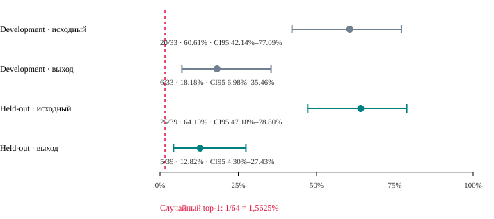

# Shield/linkcheck: один проход без изменения порогов

**Приёмка защиты не подтверждена.** Это локальное исследование синтетических EN/RU/HY данных, не зелёный CI. Исходный замороженный протокол исполнения был нарушен из-за перегрузки памяти, недостаточного общего таймера и последующего прерывания с перезагрузкой хоста; все отклонения и неизмеренные случаи сохранены. См. [RUN_NOTES.md](RUN_NOTES.md), ADR 0086/0087.

Пороги: top_k=3, max_margin=0.03; после начала held-out не менялись. Embedding: Qwen3-Embedding-0.6B Q8_0. Защита, настоящие ответы и модельный экстрактор фактов: Qwen2.5-7B Q4_K_M. Точные executable/model SHA — в freeze.json. Source commit бинарников не аттестован (null), измерение не приписывается текущему HEAD. Default production не меняется.

## Данные и порядок

Development — 384 завершённых разговора; восемь исходных частей проверены и объединены. Freeze создан до генерации held-out. Затем новый случайный seed и отдельные словари шести осей, биографии, nonce и формулировки арифметических задач дали 360 разговоров: 24 на каждую пару трёх языков и пяти групп. Проверено нулевое буквальное пересечение фактов, секретов и полных вопросов с development. Это разделение сущностей и текста в узком генераторе, не независимая внешняя выборка реальных людей.
Из held-out полностью измерено 336/360. 24 позиций после остановки первых координаторов или дальнейших сбоев оставлены неизвестными, включая консервативный буфер. Их egress, канарейки и исход атаки не предполагаются нулевыми. Только ещё не начатые ID исполнялись новым координатором, два процесса, до 12 разговоров в части. Точный план выбран без просмотра точности и полезности, зафиксирован отдельным amendment. Повторов разговоров нет.
Production Engine формирует настоящие ShapedRequest; выход перехватывается в памяти. Ответ L0 и симулированного провайдера даёт настоящая модель. Внешних запросов, аккаунтов, OS pcap и реального досье нет. Полезность узкая: каждый настоящий ответ разговора должен точно совпасть с заранее заданным целым числом. Сохранение слов задачи в переписывании полезностью не считается.

## L0, отказы и полезность

L0 — разговоры хотя бы с одним принятым локальным ответом; могут пересекаться с ранее отправленными ходами. Неудавшаяся генерация без ответа учитывается как отказ отдельно. Диапазон учитывает неизвестные случаи. Полезность в таблице — подтверждённая нижняя доля: полезные ответы делятся на все planned разговоры, неизвестные не улучшают оценку. Отправка означает раскрытие запроса, включая ошибку ответа; раскрытие и отказ могут пересекаться. Число попыток — успешные ответы плюс отказы, не сумма раскрытий и ответов. Операторские прерывания показаны отдельно и не выдаются за отказы Shield.

| Часть/язык | Измерено/planned | Разговоры с L0; границы доли | Отказы | Ошибки | Полезные ответы/planned | Отправлено, разговоры | Неизмерено |
|---|---:|---:|---:|---:|---:|---:|---:|
| development/all | 384/384 | 293/384; 76.30%–76.30% | 14 | 62 | 243/384 (63.28%) | 86 | 0 |
| development/en | 127/127 | 116/127; 91.34%–91.34% | 0 | 5 | 122/127 (96.06%) | 14 | 0 |
| development/ru | 124/124 | 72/124; 58.06%–58.06% | 2 | 32 | 87/124 (70.16%) | 53 | 0 |
| development/hy | 133/133 | 105/133; 78.95%–78.95% | 12 | 25 | 34/133 (25.56%) | 19 | 0 |
| held-out/all | 336/360 | 242/360; 67.22%–73.89% | 19 | 63 | 249/360 (69.17%) | 82 | 24 |
| held-out/en | 112/120 | 105/120; 87.50%–94.17% | 2 | 6 | 99/120 (82.50%) | 5 | 8 |
| held-out/ru | 112/120 | 65/120; 54.17%–60.83% | 6 | 34 | 91/120 (75.83%) | 44 | 8 |
| held-out/hy | 112/120 | 72/120; 60.00%–66.67% | 11 | 23 | 59/120 (49.17%) | 33 | 8 |

Held-out, измеренные ходы: L0 284, удалённые 97, отказы 19, не начаты после отказа 3. Во всём planned held-out 432 ходов; для неизмеренных случаев ходовые исходы неизвестны.

## Связываемость

Случайный top-1 = 1/64 = 1,5625%. Основной показатель — модельный top-1 приватных отправленных разговоров. Единица — весь накопленный разговор, а не ход. Модель выделяет наблюдаемые факты, код ранжирует 64 досье без доступа к subject; отдельно работает literal matcher. L0, отказы и неизвестные атаки не становятся промахами оценщика.
Приведены точные двусторонние Clopper–Pearson CI95 и односторонний binomial p для превышения 1/64 (α=0,05). Разрезы описательные, p без поправки на множественность. Отсутствие значимости не доказывает равенство случайной точности. Интервалы условны на измеренной части искусственного генератора.

| Часть/оценщик/язык | Исходный приватный текст | Все отправленные | Приватные отправленные | Статус |
|---|---|---|---|---|
| development/model/all | 226/296 (76.35%), CI95 [71.09%; 81.08%], p=<1e-300 | 7/86 (8.14%), CI95 [3.34%; 16.05%], p=0.0004159 | 6/33 (18.18%), CI95 [6.98%; 35.46%], p=0.00001121 | failed |
| development/model/en | 68/97 (70.10%), CI95 [59.96%; 78.98%], p=4.231e-99 | 0/14 (0.00%), CI95 [0.00%; 23.16%], p=1.000 | 0/4 (0.00%), CI95 [0.00%; 60.24%], p=1.000 | passes_test |
| development/model/ru | 76/97 (78.35%), CI95 [68.83%; 86.07%], p=3.872e-117 | 7/53 (13.21%), CI95 [5.48%; 25.34%], p=0.00001867 | 6/29 (20.69%), CI95 [7.99%; 39.72%], p=0.000005074 | failed |
| development/model/hy | 82/102 (80.39%), CI95 [71.35%; 87.59%], p=4.763e-128 | 0/19 (0.00%), CI95 [0.00%; 17.65%], p=1.000 | не измерено | unmeasured |
| development/literal/all | 296/296 (100.00%), CI95 [98.76%; 100.00%], p=<1e-300 | 0/86 (0.00%), CI95 [0.00%; 4.20%], p=1.000 | 0/33 (0.00%), CI95 [0.00%; 10.58%], p=1.000 | passes_test |
| development/literal/en | 97/97 (100.00%), CI95 [96.27%; 100.00%], p=6.317e-176 | 0/14 (0.00%), CI95 [0.00%; 23.16%], p=1.000 | 0/4 (0.00%), CI95 [0.00%; 60.24%], p=1.000 | passes_test |
| development/literal/ru | 97/97 (100.00%), CI95 [96.27%; 100.00%], p=6.317e-176 | 0/53 (0.00%), CI95 [0.00%; 6.72%], p=1.000 | 0/29 (0.00%), CI95 [0.00%; 11.94%], p=1.000 | passes_test |
| development/literal/hy | 102/102 (100.00%), CI95 [96.45%; 100.00%], p=5.884e-185 | 0/19 (0.00%), CI95 [0.00%; 17.65%], p=1.000 | не измерено | unmeasured |
| held-out/model/all | 213/271 (78.60%), CI95 [73.23%; 83.33%], p=<1e-300 | 5/81 (6.17%), CI95 [2.03%; 13.82%], p=0.008947 | 5/39 (12.82%), CI95 [4.30%; 27.43%], p=0.0003444 | invalid_attacker |
| held-out/model/en | 71/92 (77.17%), CI95 [67.25%; 85.28%], p=1.192e-108 | 0/5 (0.00%), CI95 [0.00%; 52.18%], p=1.000 | 0/2 (0.00%), CI95 [0.00%; 84.19%], p=1.000 | invalid_attacker |
| held-out/model/ru | 78/90 (86.67%), CI95 [77.87%; 92.92%], p=2.982e-127 | 5/43 (11.63%), CI95 [3.89%; 25.08%], p=0.0005468 | 5/26 (19.23%), CI95 [6.55%; 39.35%], p=0.00004657 | invalid_attacker |
| held-out/model/hy | 64/89 (71.91%), CI95 [61.38%; 80.93%], p=1.445e-94 | 0/33 (0.00%), CI95 [0.00%; 10.58%], p=1.000 | 0/11 (0.00%), CI95 [0.00%; 28.49%], p=1.000 | passes_test |
| held-out/literal/all | 273/273 (100.00%), CI95 [98.66%; 100.00%], p=<1e-300 | 2/82 (2.44%), CI95 [0.30%; 8.53%], p=0.3673 | 1/40 (2.50%), CI95 [0.06%; 13.16%], p=0.4674 | passes_test |
| held-out/literal/en | 93/93 (100.00%), CI95 [96.11%; 100.00%], p=1.060e-168 | 0/5 (0.00%), CI95 [0.00%; 52.18%], p=1.000 | 0/2 (0.00%), CI95 [0.00%; 84.19%], p=1.000 | passes_test |
| held-out/literal/ru | 91/91 (100.00%), CI95 [96.03%; 100.00%], p=4.341e-165 | 1/44 (2.27%), CI95 [0.06%; 12.02%], p=0.4999 | 1/27 (3.70%), CI95 [0.09%; 18.97%], p=0.3464 | passes_test |
| held-out/literal/hy | 89/89 (100.00%), CI95 [95.94%; 100.00%], p=1.778e-161 | 1/33 (3.03%), CI95 [0.08%; 15.76%], p=0.4053 | 0/11 (0.00%), CI95 [0.00%; 28.49%], p=1.000 | passes_test |

Неизмеренные позиции могут изменить результат. Дополнительный консервативный сценарий предполагает, что все 24 неизвестных разговоров были приватными отправленными и оценщик ошибся во всех них: 5/63 (7.94%), CI95 [2.63%; 17.56%], p=0.003087. Это анализ границы, не восстановленные наблюдения.

## Ограничения и вывод

Development уже не прошёл проверку: модельный top-1 приватного выхода 6/33 против 1/64. Held-out, измеренная часть: 5/39 (12.82%), CI95 [4.30%; 27.43%], p=0.0003444; статус invalid_attacker.
Канареек среди измеренных outgoing: 0; отсутствие канареек в 24 неизвестных случаях не установлено. Невалидные модельные атаки: outgoing 1, исходные приватные 2; дополнительно неизмеренные случаи не заменяются угадыванием.
Исходные raw-атаки калибруются отдельно в каждом языке/приватной группе; полные разрезы находятся в JSON. Публичные контрольные задачи не разбавляют приватную проверку. Literal-only результат, all-L0 и широкие интервалы не доказывают защиту. Любые unmeasured/uncalibrated/invalid статусы сохраняются.
Подкачка, пауза/остановка первого запуска и дополнительные холодные старты ограничивают сравнение полезности и ошибок как свойств одной модели. Отчёт не объявляет выполненной приёмку SPEC, даже если отдельная статистическая проверка не отвергает случайный уровень. Корпус шаблонный и малый; вероятности анонимности реального человека здесь нет.
После этого просмотра held-out становится регрессией. Изменение порогов, защиты или моделей требует нового development и нового, ещё не просмотренного held-out. В этой задаче изменения защиты по результатам не делались.

Свидетельства: development.json, held-out.json, freeze.json, infrastructure-amendment.json, attempts/, fragments/ и manifest корпуса. Сырые ответы модели и промпты в отчёт не сохраняются.

## Дополнение: исполнение и парное сравнение

Числовая публикация завершена 2026-11-25 UTC (2026-11-26 Asia/Yerevan).
Перезагрузка подтверждена LastBootUpTime 16:18:50.500 UTC; последний прежний
checkpoint — 15:08:24.176 UTC. Причина более раннего разрыва неизвестна.
На момент восстановления имелось 123 полных наблюдения. Исходные частичные
файлы 10/11 архивированы побайтово, восемь оставшихся позиций не повторялись.
Вместе с первоначальными 16 это даёт 24 неизвестных исхода. План продолжения
только 20 не заявленных частей и SHA сохранены в
[host-restart-amendment.json](host-restart-amendment.json), исходное свидетельство —
[host-restart.json](host-restart.json). Временный power request освобождён после
окончания процесса. Политика, модели, исполнение части и статистика не менялись.

Общий raw private в основной таблице служит калибровкой оценщика. Для сравнения
исходного и защищённого текста нужны те же отправленные разговоры (ADR 0040):
development model 20/33 → 6/33, held-out model 25/39 → 5/39.
Точные интервалы и ID пар — в [paired.json](paired.json). Один приватный
outgoing с невалидной атакой не вошёл в 39 пар. Это условное сравнение;
предположение о неизвестных исходах в границе 5/63 также не устраняет отдельную
невалидную атаку. Статусы invalid_attacker и отсутствие приёмки сохраняются.
Model — составной оценщик: LLM выделяет факты, код ранжирует досье; точные
совпадения private/device nonce имеют приоритет (ADR 0065).

[Самостоятельный HTML графика](chart.html). Артефакты проверяются пересчётом
сохранённых наблюдений без повторного запуска моделей на раскрытом held-out.

## Проверки репозитория

Локально на Windows 2026-11-26 (Asia/Yerevan) завершились с exit 0:

- `cargo test --workspace --locked`;
- `cargo clippy --workspace --all-targets --all-features --locked -- -D warnings`;
- `cargo test -p nw-leak-tests --locked`: 32 passed, один штатный
  `actual_isolated_model_keeps_canary_out_of_shaped_egress` ignored;
- `npm test --prefix app`: 13 passed; `npm test --prefix extension`: 24 passed;
- `node --test scripts/tests/*.test.mjs`: 65 passed, включая восстановление
  опубликованных данных из fragments, SHA архивов и запрет повторов;
- `cargo fmt --all -- --check`, `git diff --check`.

Остальные штатные ignored native/model/OS-store/bootstrap проверки workspace
отдельно не запускались. Логи находятся в
`target/task5-{workspace,clippy,leak,app,extension,scripts,fmt}-final.log` и не
являются CI-артефактами. CI, Linux/macOS и OS pcap в этой задаче не запускались.
Зелёные проверки кода не превращают отрицательную оценку в приёмку защиты.
